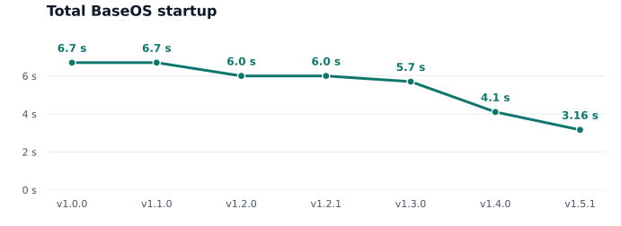

# BaseOS

BaseOS is a small, fast operating system for Anbernic RG XX handhelds. It
handles the hardware and starts your choice of frontend:
[NextUI](https://nextui.loveretro.games), [Slot](https://slot-cfw.fyi),
[spruceOS](https://spruceui.github.io), or your own. It has no menu of its own.

**[Installation guide](https://github.com/pvaibhav/BaseOS/wiki/BaseOS-Install-Guide)**

## Startup time



Includes kernel loading. Frontend loading comes on top.

v1.4.0 also loads **NextUI about 0.7 seconds faster** and **Slot about
0.3 seconds faster**.

## Features

- Display, sound, controls, Wi-Fi, HDMI, LEDs and deep sleep support.
- A small system with minimal background activity.
- Automatic expansion to use the full SD card on first boot.
- Updates by copying one file to your card. Games, saves and settings stay put.
- SSH/SFTP over Wi-Fi and adb over USB, enabled by default.
- USB storage mode to access your card from a computer.
- Optional startup sound: put `startup_sound.wav` at the root of TF1's BASEOS
  partition. Use a short WAV clip; other formats are not supported.

## Installation and updates

For a fresh install, [download your model's BaseOS release](https://github.com/pvaibhav/BaseOS/releases/latest),
unzip its `.img.zip` and flash the `.img` to TF1. Flashing erases the card.
Then add a frontend using TF1's visible `BASEOS` volume or a separate TF2 card.
**Do not reformat TF1 after flashing BaseOS.** A usable TF2 card takes priority.

Use one frontend per card. FAT32 works with all three frontends; NextUI also
supports exFAT on TF2. Follow the
[installation guide](https://github.com/pvaibhav/BaseOS/wiki/BaseOS-Install-Guide)
for one-card or two-card setup.

To update BaseOS, copy your model's `.bosupd` to the root of your frontend card
and restart. Keep power connected during the v1.4.0 update's one-time startup
optimisation, and let it finish without switching off. From v1.5.2 the faster
startup installs at any battery level; it takes a few seconds on the first
start after the update, while the screen shows "INSTALLING FAST STARTUP".

If something about startup looks wrong, `baseos-boot.log` at the root of the
card says which startup ran and why.

### Frontends

- **NextUI:** [official v6.15.0 and later](https://github.com/LoveRetro/NextUI/releases/latest)
  support H700 natively. Extract the `-base.zip` or `-all.zip` archive and copy
  its contents to your frontend card's root. Keep `MinUI.zip` zipped; BaseOS
  installs it automatically. A separate H700 fork and the stock-OS `dmenu.bin`
  setup are unnecessary. [NextUI installation guide](https://nextui.loveretro.games/getting-started/installation/).
- **Slot:** extract its [H700 release](https://github.com/BrandonKowalski/slot/releases/latest)
  and copy the contents of `slot-<version>` to the card root, including the
  complete `System/` folder. Put unzipped games in `Games/GB/`, `Games/GBC/`
  or `Games/GBA/`, and optional BIOS files in `BIOS/`. Update by replacing
  `System/` with the folder from the new release. [Slot guide](https://slot-cfw.fyi).
- **spruceOS:** extract the full [release archive](https://github.com/spruceUI/spruceOS/releases/latest)
  and copy all contents, including hidden folders, to the card root. It should
  contain `spruce/scripts/runtime.sh`. The
  [spruceOS Installer](https://github.com/spruceUI/spruceOS-Installer/releases/latest)
  can set up a separate TF2 card; skip its TF1 image step if BaseOS is already
  installed. [spruceOS installation guide](https://github.com/spruceUI/spruceOS/wiki/01.-Installation-Instructions).
- **Your own frontend:** add `System/launch_frontend.sh` or a glibc AArch64
  binary at `System/frontend`. The binary takes priority; scripts run through
  `/bin/sh`. Both run from the card root and need no executable bit.

## Settings

Edit `baseos.conf` at the root of TF1's visible partition, then restart.
Settings stay on TF1 even when your frontend is on TF2, and survive OS updates.

```ini
hostname=my-handheld
mdns=true
```

- **`hostname`**: your device's network name. Defaults to its model ID, such as
  `rg34xxsp`. Use 1–63 letters, digits or hyphens, with no hyphen at either end.
- **`mdns`**: connect using `<hostname>.local` over Wi-Fi. Enabled by default;
  set `false` to disable it.
- **`ssh_password`**: set your SSH password. Defaults to `root` if omitted or
  empty. It is stored as plain text on the card, so don't reuse an important
  password. Write it without quotes; surrounding spaces are trimmed.
- **`headphone_pop_fix`**: set `true` to try the headphone exit-pop fix. Off by
  default because it can use more battery while awake. The speaker pop fix is
  always enabled. See [audio support](docs/05-runtime-power-network.md#speaker-and-headphone-pop-repair).

Omitted settings use their defaults. Lines starting with `#` are comments;
`#` within an SSH password is part of the password.

## USB access

For adb, connect a data-capable USB-C cable before powering on. If adb stops
working after unplugging it, restart with the cable connected.

For USB storage, hold **MENU** while connecting the cable. If the handheld
doesn't start automatically, hold Power for 3–4 seconds. Release Power when it
starts, but keep holding MENU until you see **“USB STORAGE: EJECT BEFORE
RESTART”**.

Eject the drive on your computer before restarting the handheld. Restart
without holding MENU to return to normal.

## Supported devices

- Anbernic RG28XX
- Anbernic RG34XX
- Anbernic RG34XX SP
- Anbernic RG35XX Plus and RG35XX 2024
- Anbernic RG35XX H
- Anbernic RG35XX Pro
- Anbernic RG35XX SP
- Anbernic RG40XX H
- Anbernic RG40XX V
- Anbernic RG CubeXX
- Anbernic RG SP

## How it works

BaseOS uses Anbernic's bootloader, kernel and hardware drivers for H700
handhelds, with a minimal BusyBox-based system in place of the stock Ubuntu
userland. Version 1.3.0 stores the kernel in compressed form to reduce loading
work, while keeping the kernel itself unchanged.

Build instructions and technical documentation are in
[CONTRIBUTING.md](CONTRIBUTING.md).
