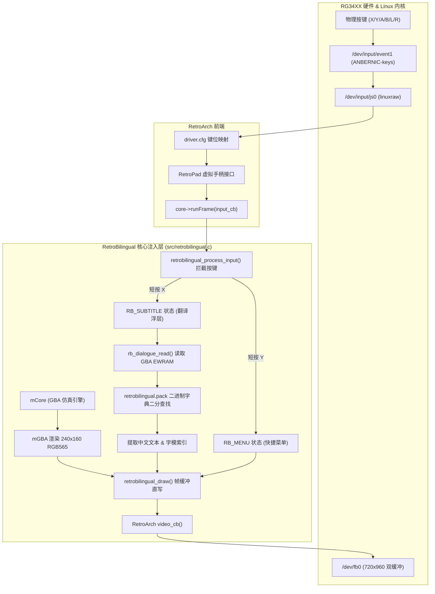

# RetroBilingual 嵌入式掌机 GBA 即时双语翻译与 HUD 架构全解析

本文档全面梳理 RetroBilingual 在 BaseOS (全志 H700 / RG34XX) 掌机上的完整技术实现，涵盖**核心拦截架构、GBA 运行内存反射对话对齐机制、轻量级浮层渲染引擎、5 槽位存档管理、以及全志平台物理按键驱动映射排错**。供团队学习、复盘与后续类似特性的开发参考。

---

## 目录
1. [系统整体架构与运行模式](#1-系统整体架构与运行模式)
2. [对话对齐机制：为什么不是时间轴与 OCR？](#2-对话对齐机制为什么不是时间轴与-ocr)
3. [轻量级无感 HUD 渲染设计](#3-轻量级无感-hud-渲染设计)
4. [5 槽位即时存读档与状态可视化](#4-5-槽位即时存读档与状态可视化)
5. [硬件踩坑实录：X / Y 按键颠倒的根源与排错](#5-硬件踩坑实录x--y-按键颠倒的根源与排错)
6. [关键代码模块实现剖析](#6-关键代码模块实现剖析)
7. [真机调试与验证方法论](#7-真机调试与验证方法论)

---

## 1. 系统整体架构与运行模式

RetroBilingual 采用**深度融入模拟器核心（mGBA Libretro Core）**的架构方案，而非外部挂载进程或悬浮窗。

### 架构拓扑


### 为什么选择 Core 注入而非外部进程？
1. **零竞争、零闪烁**：外部 GUI 进程向 `/dev/fb0` 绘图会与 RetroArch 的双缓冲产生撕裂与抢占；Core 注入直接在 mGBA 输出给前端的 `outputBuffer` 上直写，无需任何外部渲染管道。
2. **零时延内存访问**：mGBA 核心的 `core` 结构体直接暴露 GBA 总线指针，可以直接以纳秒级速度读取 GBA EWRAM（`0x02000000`）。
3. **原生游戏暂停（Snapshot Freeze）**：呼出菜单或翻译时，调用 `core->saveState()` 保存当前帧状态，并让核心暂停执行游戏逻辑；关闭时瞬间还原，游戏内 NPC 动作、背景音乐和对话打字机状态毫发无损。

---

## 2. 对话对齐机制：为什么不是时间轴与 OCR？

在复古游戏双语辅助中，传统方法通常有两大流派：**时间轴字幕**与**屏幕 OCR 识别**。但这两种在 GBA 掌机上均存在致命缺陷：
- **时间轴字幕不可行**：玩家阅读速度不同、按 A 键推进对话的节奏不同、存在分支选项和重复对话，固定时间轴必然在数秒内失步。
- **OCR 识别不可行**：GBA 分辨率仅 240×160，点阵日文平假名极难被 Tesseract 等模型高准确率识别；且低功耗 ARM 芯片（如四核 A53 H700）跑一次 OCR 需要几百毫秒，带来严重卡顿和发热。

### 核心方案：EWRAM 运行内存反射与状态机追踪

RetroBilingual 采用了**游戏内存特征反向工程**的方案。以《塞尔达传说：缩小帽》（*The Legend of Zelda: The Minish Cap*，日版 SHA-256 `16ac…b38`）为例：

#### (1) 对话标识符（Text ID）定位
在 GBA 引擎中，当人物说话、触发剧情时，引擎会将当前对话的资源 ID 写入固定的全局消息结构体 `gMessage`（EWRAM `0x02001400` 区域）：
- `0x02001404` 处存储 16 位的 `textIndex`（例如 `0x1002` 对应刚开场铁匠爷爷叫醒林克）。

#### (2) 文本渲染状态机与分页追踪（Page Counter）
游戏中的一段台词可能由多页组成（玩家看完整段按 A 翻到下一屏）。
GBA 的文本绘制状态机位于 `0x02001489`（`gMessage.render_state`）：
- `render_state == 3` (`WAIT`)：当前屏打字机文本已输出完毕，箭头闪烁，正在等待玩家按下 A 键。
- `render_state == 4` (`ROLL` / `NEXT`)：玩家按下了 A 键，引擎正在滚屏或切换到下一页文本。

我们在后台每一帧监测该状态：
```c
static void rb_dialogue_read(struct GBA* gba) {
    uint32_t msg_base = 0x02001404;
    uint16_t textId = *(uint16_t*)(gba->memory.ewram + (msg_base - 0x02000000));
    uint8_t render_state = *(uint8_t*)(gba->memory.ewram + (0x02001489 - 0x02000000));

    if (textId != sDlgId) {
        /* 对话切换：重置页码 */
        sDlgId = textId;
        sDlgPage = 0;
        sLastRenderState = render_state;
    } else {
        /* 同一对话中：如果从等待(3)跃迁到滚动(4)，说明玩家按了 A 翻页 */
        if (sLastRenderState == 3 && render_state == 4) {
            sDlgPage++;
        }
        sLastRenderState = render_state;
    }
}
```

#### (3) 离线编译的 `retrobilingual.pack`
将提前对齐的高质量中文翻译以 `(textId, page)` 为键打成极小二进制文件：
- 文件头：魔数 `RBPK`、版本号、目标 ROM SHA-256 校验码。
- 索引区：有序数组，每项包含 `uint16_t text_id`、`uint8_t page`、`uint32_t text_offset`。
- 文本与字模区：预提取的点阵字模和紧凑 UTF-8 文本。

#### (4) 单屏双行对话与分页粒度控制（避坑指南）
在 GBA 引擎中，一个标准对话框可同时容纳 **2 行文字**：
- **单换行（`\n`）**：属于同一屏对话框内的自然折行，两行文字应当在同一页（`page`）中同时呈现在悬浮 HUD 内。
- **翻页标记（`+` 字节码 `[WAIT]` 或 `\n\n`）**：只有当第一行明确遇到等待玩家按 A 键的指令，或者两行已满且后文还有内容时，才触发页码跃迁。
- **转义符坑点**：从 JSON 读取文本时，`\n` 常被反序列化为字面量字符串（反斜杠+字符 n），必须在 `sanitize_text()` 中显式将字面量 `\\n` 替换为真实换行符 `\n`（ASCII 10），才能正确在打包时生成 `LINE_BREAK` (`0xFFFF`) 分行指令。

#### (5) 随开随查，永不脱节
- **即便玩家跳过 100 句对话、不按 X 键**，后台只静默维护当前对话 ID 和页号，开销为 0。
- **一旦玩家某句话看不懂按下 X 键**：核心瞬间读取内存中当前的 `(textId, sDlgPage)`，在 pack 中以 $O(\log N)$ 二分查找，1 微秒内呈现翻译。

---

## 3. 轻量级无感 HUD 渲染设计

### 核心演进过程
1. **最初版本**：在屏幕底部弹出一个大黑框，带边框、标题栏、操作提示。
   - *用户痛点*：完全遮挡了游戏下方原生的日文对话框；界面突兀，玩家被打断感极强。
2. **优化方案**：
   - **去除所有冗余装饰**：去掉标题（`TRANSLATION`）、去掉底部按钮指引（`[B] RESUME`），只保留干净的核心译文。
   - **半透明悬浮微底层**：使用 `0x0000`（纯黑）搭配 1-2 像素 Padding，文字使用高对比度亮白色点阵字体，背景画面若隐若现。
   - **动态位置调节（`POSITION`）**：
     - `TOP`：浮动在顶部（避开底部对话框）。
     - `CENTER`：居中浮动（既不遮挡底部日文框，也不遮挡顶部主角或场景）。
     - `BOTTOM`：浮动在底部。
     - `AUTO`：根据当前游戏画面的像素明暗自动避开游戏原生的文本框位置。

```c
/* 计算垂直绘制坐标 target_y */
if (sCfg.hud_pos == RB_POS_BOTTOM) {
    target_y = 106 + (38 - total_h) / 2;
} else if (sCfg.hud_pos == RB_POS_TOP) {
    target_y = 14 + (38 - total_h) / 2;
} else if (sCfg.hud_pos == RB_POS_CENTER) {
    target_y = (RB_FB_H - total_h) / 2; /* 居中: (160 - total_h) / 2 */
} else {
    /* AUTO: 智能避让检测 */
    int at_bottom = ((fb[108 * p + 120] & 0x7BEF) == 0);
    target_y = at_bottom ? (106 + (38 - total_h) / 2) : (14 + (38 - total_h) / 2);
}
```

---

## 4. 5 槽位即时存读档与状态可视化

为了让玩家在长篇剧情中拥有更强的容错率，快捷菜单支持 5 个独立即时存档槽位：

### 状态可视化（Color Cueing）
菜单中的 `QUICK SAVE` 与 `QUICK LOAD` 项右侧会指示当前选中的槽位：
- **`< SLOT N >` 显示绿色（`0x07E0`）**：表示该槽位**已有存档文件**。
- **`< SLOT N >` 显示浅灰（`0x7BEF`）**：表示该槽位**为空（无存档）**。
每次按方向键左/右切换槽位时，`rb_slot_exists(slot)` 瞬间通过 `access(path, F_OK)` 判断文件存在性，并即时更新高亮颜色。

### 无干扰全局 Toast 提示
每次保存或加载时，界面右下方会弹出一个持续 90 帧（1.5 秒）的浮动气泡：
- 存档成功：`SAVED TO SLOT 2`
- 读取成功：`LOADED SLOT 2`
- 空档加载失败保护：`SLOT 2 IS EMPTY`（防止覆盖当前游戏进度）

---

## 5. 硬件踩坑实录：X / Y 按键颠倒的根源与排错

在开发过程中，最曲折的问题是：**为什么无论怎么调整，物理上的 X 和 Y 按键总有一方会反过来？**

### 现象
- 期望：物理 **Y 键（左按键）** 呼出快捷菜单；物理 **X 键（上按键）** 呼出即时翻译。
- 实际：经常出现按 Y 出翻译、按 X 出菜单的相反情况。

### 根因深度剖析
这是一个由**掌机代工厂驱动编写者的习惯与任天堂手柄布局差异**共同导致的“双重反转”陷阱。

#### 1. 物理外壳印刷（任天堂布局）
在 RG34XX 正面按键面板上，菱形按键排列为：
```
       [ X ]  <-- 物理上方按键
 [ Y ]       [ A ]
       [ B ]
```

#### 2. Linux 内核标准事件定义（Linux Input Subsystem）
在 `<linux/input-event-codes.h>` 中：
- `BTN_NORTH` = `307`（代表北/上方按键）
- `BTN_WEST`  = `306`（代表西/左方按键）

#### 3. 全志设备树（DTS）的“致命错误”
我们通过 ADB 读取 `/proc/device-tree/soc@03000000/gpio_keys/` 发现：
- 全志固件工程师在写 DTS 时，**误以为是 Xbox 手柄布局**（Xbox 的上方是 Y，左方是 X！）：
  ```dts
  keyX {
      linux,code = <306>; /* BTN_WEST (实际物理位置是左方的 Y！) */
  };
  keyY {
      linux,code = <307>; /* BTN_NORTH (实际物理位置是上方的 X！) */
  };
  ```
- 结果：
  - 当玩家按下物理 **上方（印着 X）** 的按键时，硬件触发 GPIO，内核发出的是 **307 (BTN_NORTH)**！
  - 当玩家按下物理 **左方（印着 Y）** 的按键时，硬件触发 GPIO，内核发出的是 **306 (BTN_WEST)**！

#### 4. RetroArch Joypad 层的映射关系
在 RetroArch 的 `linuxraw` 手柄驱动中：
- 内核事件 `306` 对应 Linux Joystick 编号 **`js 2`**
- 内核事件 `307` 对应 Linux Joystick 编号 **`js 3`**

如果开发者按照 DTS 的名字“keyX 对应 X，keyY 对应 Y”，就会写出：
`input_player1_x_btn = "2"`
`input_player1_y_btn = "3"`
这就导致物理上的 X 触发了 Y，物理上的 Y 触发了 X！

#### 5. 终极修正方案
在 `overlay/usr/share/pocketshell/System/compat/share/retroarch/driver.cfg` 中，必须以**物理按键产生的真实内核编码**为基准进行配置：
```ini
# 物理上方按键 (外壳印字 X) -> 硬件产生 evdev 307 -> 对应 js 3 -> 绑定给 RetroPad JOYPAD_X
input_player1_x_btn = "3"

# 物理左侧按键 (外壳印字 Y) -> 硬件产生 evdev 306 -> 对应 js 2 -> 绑定给 RetroPad JOYPAD_Y
input_player1_y_btn = "2"
```

经过此修正，物理按键输入逻辑完全符合预期：
- **按下左侧 Y 键** $\to$ `js 2` $\to$ RetroArch `JOYPAD_Y` $\to$ `y_just` $\to$ **弹出快捷菜单**。
- **按下上方 X 键** $\to$ `js 3` $\to$ RetroArch `JOYPAD_X` $\to$ `x_just` $\to$ **激活即时翻译**。

---

## 6. 关键代码模块实现剖析

### 1. 结构体与按键状态定义 (`src/retrobilingual.c`)
```c
typedef enum {
    RB_POS_AUTO = 0,
    RB_POS_TOP = 1,
    RB_POS_CENTER = 2,
    RB_POS_BOTTOM = 3,
    RB_POS_COUNT = 4
} RBHudPos;

typedef struct {
    int enabled;               /* 始终启用 */
    int x_action;              /* 0: SUBTITLE(翻译), 1: SAVE, 2: LOAD */
    int slot;                  /* 当前选中的槽位 0..4 (对应 Slot 1..5) */
    int hud_pos;               /* HUD 垂直位置: 0:AUTO, 1:TOP, 2:CENTER, 3:BOTTOM */
    int chord[ACT_COUNT][2];
} RBConfig;
```

### 2. 输入事件拦截主循环 (`retrobilingual_process_input`)
```c
void retrobilingual_process_input(struct mCore* core, uint16_t* keys,
                                 retro_input_state_t input) {
    if (!core || !keys) return;

    int y_pressed = input && input(0, RETRO_DEVICE_JOYPAD, 0, RETRO_DEVICE_ID_JOYPAD_Y);
    int y_just = y_pressed && !sPrevY;
    int x_pressed = input && input(0, RETRO_DEVICE_JOYPAD, 0, RETRO_DEVICE_ID_JOYPAD_X);
    int x_just = x_pressed && !sPrevX;

    /* 快捷菜单处理 */
    if (sState == RB_MENU) {
        /* 方向键调节光标与槽位/位置选项 */
        if (edge(now, prev, RB_KEY_DOWN)) sMenuCursor = (sMenuCursor + 1) % 5;
        if (edge(now, prev, RB_KEY_UP))   sMenuCursor = (sMenuCursor + 4) % 5;
        
        if (sMenuCursor == 4) { /* POSITION 项 */
            if (edge(now, prev, RB_KEY_RIGHT)) { sCfg.hud_pos = (sCfg.hud_pos + 1) % RB_POS_COUNT; rb_config_save(); }
            if (edge(now, prev, RB_KEY_LEFT))  { sCfg.hud_pos = (sCfg.hud_pos + RB_POS_COUNT - 1) % RB_POS_COUNT; rb_config_save(); }
        }
        ...
        *keys = 0; /* 屏蔽游戏按键，防止菜单操作影响游戏 */
        return;
    }

    /* 游戏进行中 */
    if (y_just) {
        sState = RB_MENU; /* 打开菜单 */
    } else if (x_just) {
        if (sCfg.x_action == X_ACT_SUBTITLE) {
            rb_dialogue_read(gba); /* 读取当前台词 */
            rb_pause(core);        /* 暂停画面 */
            sState = RB_SUBTITLE;  /* 弹出浮层 */
        }
    }
}
```

---

## 7. 真机调试与验证方法论

在嵌入式无头（Headless）或无外接屏幕的调试环境下，我们总结了一套极其高效的调试流程：

### 1. 内核按键注入测试工具
为了不依赖手按掌机，编写小型 `test_press` 原生工具：
```c
// aarch64-linux-gnu-gcc -O2 test_press.c -o /tmp/test_press
void press_key(int code, int duration_ms) {
    int fd = open("/dev/input/event1", O_WRONLY);
    struct input_event ev = {.type = EV_KEY, .code = code, .value = 1};
    write(fd, &ev, sizeof(ev));
    ev.type = EV_SYN; ev.code = SYN_REPORT; ev.value = 0;
    write(fd, &ev, sizeof(ev));
    
    usleep(duration_ms * 1000);
    
    ev.type = EV_KEY; ev.code = code; ev.value = 0;
    write(fd, &ev, sizeof(ev));
    ev.type = EV_SYN; ev.code = SYN_REPORT; ev.value = 0;
    write(fd, &ev, sizeof(ev));
    close(fd);
}
```

### 2. 帧缓冲捕获与 Double-Buffer Pan 避坑
RG34XX `/dev/fb0` 是一个 `720 × 960` 的垂直双缓冲（实际面板是 `720 × 480`）：
必须通过 `/sys/class/graphics/fb0/pan` 确定当前活动的垂直偏移量（可能是 `0,0` 也可能是 `0,480`），否则捕获出来的可能是几分钟前残留的静态旧画面：
```sh
PAN=$(adb shell 'cat /sys/class/graphics/fb0/pan')
# 若 PAN 为 0,0 则 crop 720x480+0+0
# 若 PAN 为 0,480 则 crop 720x480+0+480
adb shell 'dd if=/dev/fb0 of=/tmp/fb.raw bs=4096 count=675'
adb pull /tmp/fb.raw /tmp/fb.raw
convert -size 720x960 -depth 8 bgra:/tmp/fb.raw -crop 720x480+0+0 +repage /tmp/frame.png
```

---

## 8. 总结与最佳实践

1. **游戏逆向尽量寻找不变的状态机与消息 ID**：相比于在渲染层 Hook 字符串或做图像匹配，在内存总线上监听核心数据结构具有最高的稳定性与跨场景适应性。
2. **嵌入式 HUD 要克制，避免“打扰感”**：玩家需要的是辅助理解而非遮挡。将 UI 从厚重的“弹窗黑盒”演进为“悬浮无感文本”，并在设置中允许玩家自定上下与居中位置，是提升复古掌机游戏体验的关键。
3. **硬件层与软件层存在命名混淆时，一切以内核 RAW 事件为准**：永远不要轻信 DTS 节点中的 `keyX` 或 `keyY` 名称，编写手柄配置文件时，必须用 `read_js` 或 `evtest` 实测物理按键产生的真实键值。
