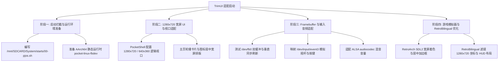

# TrimUI Smart Pro (TSP) 适配 PJOS (BaseOS) 工程方案与任务清单

## 一、设备识别与实机硬件审计结果

通过当前已连接的 USB ADB 调试通道对接入的 TrimUI 掌机进行了深度硬件与系统审查，实测数据如下：

```text
主机识别: Product: TRIMUI ADB | idVendor=18d1, idProduct=d002 | aarch64
内核版本: Linux TinaLinux 4.9.191 #407 SMP PREEMPT aarch64 GNU/Linux
硬件代号: sun50iw10p1 (全志 Allwinner A133Plus)
核心架构: 4x ARM Cortex-A53 @ 1.6 - 1.8 GHz, 64-bit ARMv8
内存配置: 1024 MB LPDDR4 (1GB DRAM)
屏幕规格: 4.96 英寸 IPS 屏, 物理分辨率 1280 × 720 (16:9 宽屏, 64Hz, 驱动 er68576)
显示通道: Allwinner DISP2 (/dev/fb0, 32-bit BGRX, 1280x13107 虚拟高度)
GPU 芯片: Imagination PowerVR Rogue GE8300 (/dev/dri/renderD128)
输入系统: 十字键 + ABXY + 4肩键 + 双模拟摇杆 (Dual Hall Sticks) + Menu/Power/Fn
虚拟手柄: 运行 trimui_inputd，输出为标准 Xbox 360 手柄协议 (/dev/input/event3, js0)
音频输出: ALSA 驱动 (/dev/snd/, 声卡 0: audiocodec), 包含 Headphone/HpSpeaker 混音节点
存储配置: 板载 eMMC GPT 分区 (/dev/mmcblk0) + 外置 MicroSD 卡槽 (/dev/mmcblk1p1 -> /mnt/SDCARD)
运行环境: glibc 2.33 动态链接环境 + busybox
```

---

## 二、RG34XX vs TrimUI Smart Pro 核心差异对比

| 维度 | RG34XX (现有平台) | TrimUI Smart Pro (目标平台) | 适配工作与改造点 |
| :--- | :--- | :--- | :--- |
| **SoC / 架构** | Allwinner H700 (4x A53 @ 1.5G) | Allwinner A133Plus (4x A53 @ 1.6G) | **同为 AArch64 架构**。我们现有的 CPU 静态编译二进制（`pocket-linux-kms`/`fbdev`、C 核心、Go 二进制）可直接在目标机无损运行。 |
| **屏幕物理分辨率** | 3.4 英寸 **720 × 480** (3:2) | 4.96 英寸 **1280 × 720** (16:9) | 需重构 UI 布局与卡片比例；GBA 原生 240×160 在 16:9 屏幕上需支持居中加边框（4× 整数缩放到 960×640 或 4.5× 全高 1080×720）。 |
| **显示子系统** | Linux DRM/KMS 直驱 (`card0`) | Allwinner DISP2 `/dev/fb0` (DRM 仅供 GPU 离屏渲染) | PocketJS 运行时需启用 `--fb /dev/fb0`（基于已有的 `pocket-linux-fbdev` 平台模块）；RetroArch 启用 SDL2/FB 驱动。 |
| **物理按键与摇杆** | 纯按键（无模拟摇杆） | **按键 + 双模拟摇杆 (Dual Sticks)** | 目标机自带 `trimui_inputd`，将摇杆转换为 `/dev/input/event3` (`ABS_X/Y/RX/RY`)。需在启动器与 RetroArch 中增加摇杆轴映射与死区滤波。 |
| **引导与文件系统** | 纯 TF 卡系统分区 (BaseOS Image) | 板载 eMMC + TF 扩展卡 | 支持 **“TF 卡免刷机 Overlay”**（首选）与 **“纯净独立镜像”** 两种引导路径。 |

---

## 三、两套适配方案对比与选型建议

### 方案 A：TF 卡免刷机 Overlay 方案（⭐ 强烈推荐首选）
- **实现原理**：
  保持机身 eMMC 出厂固件完整不动，在插入的 MicroSD 卡上部署 PJOS 套件。
  利用 TrimUI 官方固件已具备的启动挂载钩子：
  - `/mnt/SDCARD/System/starts/*.sh`（开机自动执行）
  - 或 `/mnt/SDCARD/trimui/app/MainUI`（直接拦截并替换官方主界面）
- **核心优势**：
  1. **零刷机风险**：绝对不会造成砖机，拔卡即恢复官方系统，插卡即秒进 PJOS。
  2. **硬件全免驱**：官方 BSP 内核对 Wi-Fi/蓝牙固件、音频 Codec、摇杆校准、RGB 摇杆灯效、电源管理（AXP2202）已做到 100% 调优，无需重复造轮子。
  3. **开发上线极快**：无需编译内核与移植 U-Boot，只需将前端运行时与配置文件推入 SD 卡即可立竿见影。

### 方案 B：纯净独立 BaseOS 镜像全盘刷入方案
- **实现原理**：
  参照 RG34XX 模式，从头构建适配 A133Plus 的 U-Boot SPL、设备树（DTS）与 Linux 6.x / 4.9 内核，烧录为单一 SD 启动镜像。
- **优缺点分析**：
  系统更加纯粹统一，但前期需花费大量精力攻关 A133Plus 的 U-Boot TF 卡引导参数、PowerVR GE8300 GPU 专有闭源驱动与电源休眠唤醒逻辑。

> **阶段策略**：**建议第一阶段采用方案 A（TF 免刷机方案）快速实现 PJOS 在 TrimUI 上的可用性与完美体验；第二阶段再视需要推进方案 B。**

---

## 四、详细工程任务拆解与实施路线图



### 任务 1：编写 TF 卡无缝拦截启动脚本
- **目标路径**：`/mnt/SDCARD/System/starts/00-pjos-launcher.sh`
- **主要逻辑**：
  1. 挂载 SD 卡并设置环境变量（`export POCKETJS_HOME=/mnt/SDCARD/System/pocketjs`）。
  2. 终止官方的 `MainUI` 进程，接管系统前台。
  3. 保持后台的 `trimui_inputd`（提供摇杆支持）与 `trimui_scened`（提供亮度调节）。
  4. 启动 PJOS 前端启动器 `pocket-linux-fbdev --package /mnt/SDCARD/System/pocketjs/apps/boot.pocket --fb /dev/fb0`。

### 任务 2：PocketShell 1280 × 720 宽屏视口重构
- **配置扩展**：
  - 在 `~/development/pocketshell/config/profile.ts` 中新增 TrimUI 配置（如 `trimui-tsp-fbdev`）：
    - 物理尺寸：`1280 × 720`
    - 逻辑视口：`640 × 360`（2× 整数比例，保持与 240×160 / 480×320 类似的大字号点阵风格）或自适应布局。
- **页面排版优化**：
  - 16:9 屏幕比 3:2 更宽，卡片轮播（Carousel）两翼可展示更多预览卡片。
  - 底部状态栏与顶部电量/Wi-Fi 栏横向间距自适应拉宽。

### 任务 3：显示后端接入与 Framebuffer 渲染
- **底层特性**：
  - 我们现有的 PocketJS 运行时已经内置了 `pocket-linux-fbdev` 模块。
  - 验证表明当前静态编译的 `pocket-linux-kms` 支持 `--fb /dev/fb0` 参数。
- **实施工作**：
  - 确认 `/dev/fb0` 的 `ioctl(FBIOPUT_VSCREENINFO)` 翻页机制，确保无撕裂的 60Hz 双缓冲或单缓冲直写。
  - 适配色彩空间（TrimUI 实测为 32-bit BGRX / BGRA 格式）。

### 任务 4：双模拟摇杆 (Dual Analog Sticks) 接入
- **驱动现状**：
  - TrimUI 自带的 `trimui_inputd` 会直接监听两个霍尔摇杆的模拟量信号，并通过 Linux `uinput` 生成标准 `/dev/input/event3`（VID: 045e, PID: 028e Xbox 360 手柄模式）。
- **软件适配**：
  - 在 `pjos-dpad` 或 PocketShell 内增加对 `ABS_X` / `ABS_Y` 的摇杆轴监听，加入 15% 死区判断，使左摇杆也可以直接代替十字键流畅导航 UI。
  - 右摇杆在后续 PS1 / N64 核心中直接透传。

### 任务 5：RetroArch 与 RetroBilingual 宽屏画面配置
- **GBA 画面在 1280×720 下的呈现策略**：
  - GBA 原生为 240 × 160 (3:2)。
  - **模式 1 (点对点整数 4×)**：$240 \times 4 = 960$，$160 \times 4 = 640$。在 1280×720 屏幕中居中显示（左右各空 160 像素，上下各空 40 像素），画质最为锐利无走样。两边黑边可配合复古装饰边框（Bezel）。
  - **模式 2 (高度充满 4.5×)**：$160 \times 4.5 = 720$，$240 \times 4.5 = 1080$。高度刚好撑满 720p 屏幕，左右留有 100 像素边框。
- **RetroBilingual 滤镜适配**：
  - 更新 `retrobilingual_present` 缩放管线，增加 1280×720 目标分辨率分支。
  - 双语翻译 HUD 与 Quick Menu 弹窗自适应居中或对齐游戏画面边框。

---

## 五、第一阶段落地验证步骤 (Quick Win)

1. **测试 SD 卡启动钩子**：
   在 `/mnt/SDCARD/System/starts/` 放入测试脚本，验证重启掌机后能否正常劫持官方 UI 并输出日志。
2. **测试 Framebuffer 静态画板**：
   通过编译包含 `fbdev` 的 AArch64 二进制，向 `/dev/fb0` 绘制一帧 1280×720 测试图卡，确认屏幕正常点亮显示。
3. **部署 PocketShell 原型**：
   打包 1280×720 版 `pocketshell.pocket`，在 TrimUI 上运行，验证摇杆/按键操控与流畅度。
