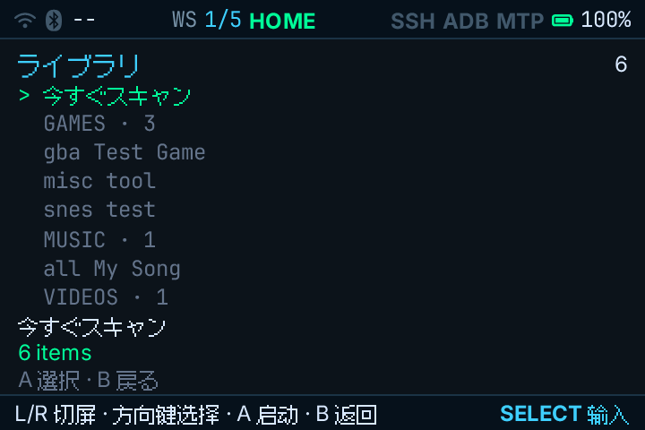
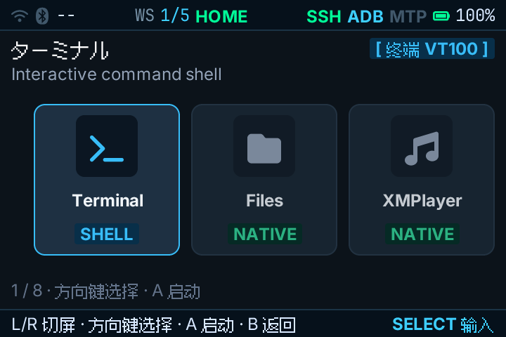
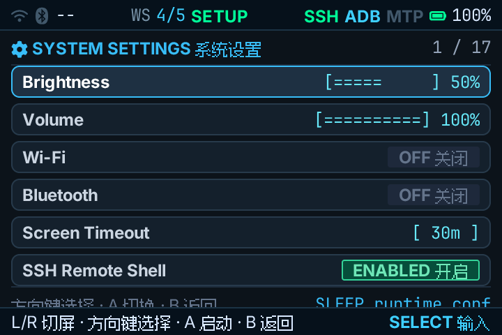
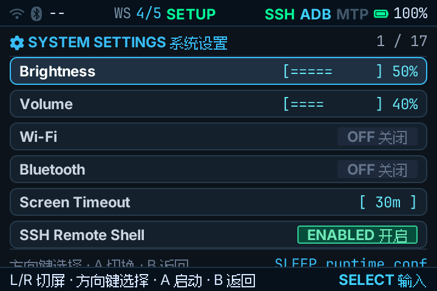
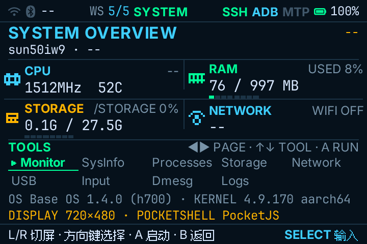
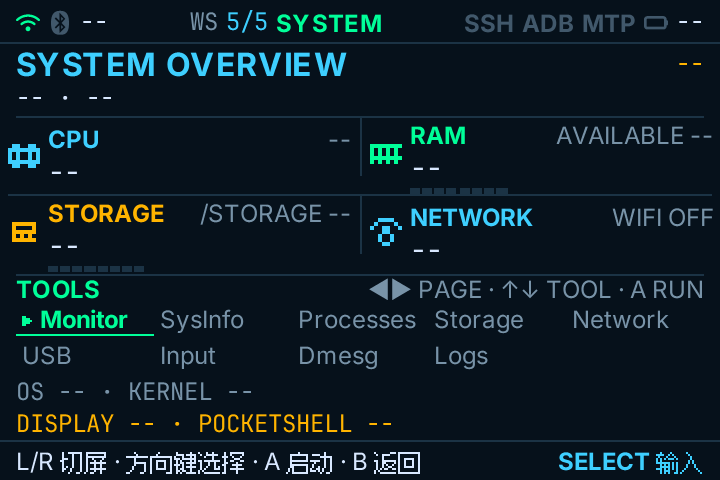
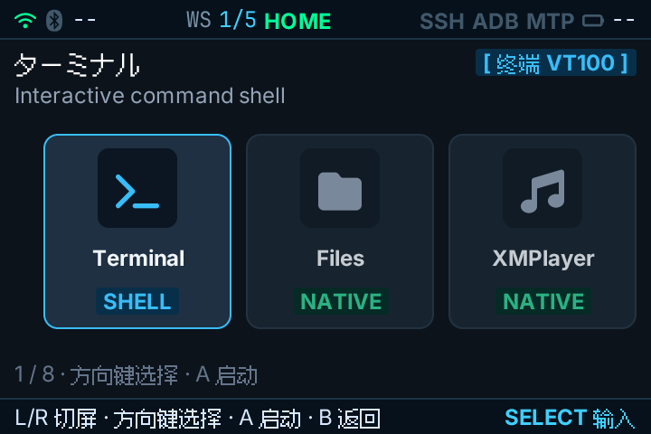

# BaseOS / PocketJS 界面截图集（2026-10-30）

设备：RG34XX / BaseOS 1.4.0。跳过 M6 的 TF 卡刷写/首启验证。本目录含 1 张本次 ADB 新抓截图，以及 6 张此前已存于仓库的历史截图；后 6 张仅为集中浏览而复制到此处，不冒充本次重新抓取。

## 本次新抓取

### 01 · Apps 当前画面

由 HX90 上 ADB 从设备 `/dev/fb0` 直接读取，显示 `WS 1/5 HOME`、Apps 列表和“今すぐスキャン”。原始 framebuffer：[BGRA 720×960](raw/framebuffer-720x960-bgra.raw.gz)；可见屏幕区域为 720×480。没有触发扫描、启动游戏或改变设置。

## 其他界面（既有历史截图）

### 02 · HOME / Terminal 卡片选中

### 03 · Settings / Brightness

### 04 · Settings / Volume

### 05 · System Overview（含当时设备遥测值）

### 06 · System Overview（数值尚未填充的另一帧）

### 07 · HOME（旧证据 README 标注为重启后）

02–07 取自仓库之前的 `docs/evidence/2026-10-30-baseos-first-boot/` 截图；只集中收录，不代表本次重拍或重新验证。05 含目标掌机当时的 CPU、内存、存储等遥测，不含 HX90 的运行数据。

## 本次设备状态

- HX90 上 `adb devices -l` 显示 RG34XX 为 `device`。
- BaseOS 1.4.0，内核 4.9.170。
- `launch_frontend.sh` 与 `pocket-linux-kms` 进程运行中；日志显示无 DRM 节点，回退至 `/dev/fb0`，`display: fbdev (timer pacing)`。
- 尝试通过 ADB 对现有输入节点发送方向键/PageDown，界面没有变化；因此本次无法重新切换并抓取其他工作区。

## 采集边界

本次只读 ADB 查询及 framebuffer 读取；没有执行 `dd`、刷写、安装、向设备 `adb push` 或修改 TF 卡/系统分区。M6 物理卡验证仍跳过。