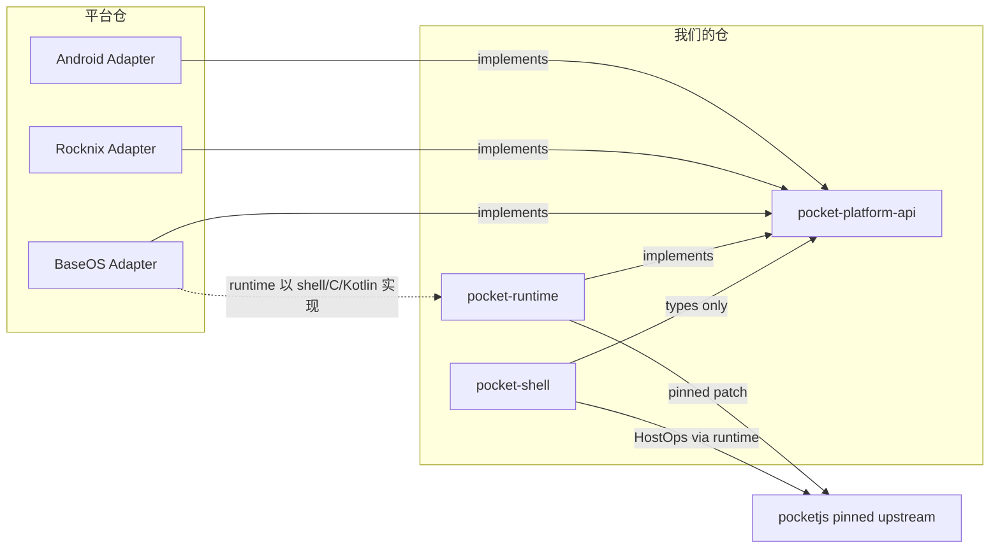

# 02 — 仓库边界

> 阶段一交付物。本文定义「什么代码归哪个仓库」「谁可以依赖谁」「版本怎么对齐」。不含实现。
>
> 依据见 [01-audit.md](01-audit.md)。任何与新仓边界冲突的现状，都以 01 的 file:line 为准。

---

## 1. 结论

今天有 4 层东西挤在 2 个仓库里：

```
PocketShell（UI + PTY/ANSI + 桥）
Pocket Runtime（pocket-linux-kms，pinned upstream）
        ↑ 三者全在 rocknix 的 pocketjs-runtime 包内，靠 patch 注入
BaseOS / Rocknix 平台
        ↑ 前者在 PJOS-LINUX，后者在 rocknix
```

目标是把边界改成**单向依赖**，并且让「平台」成为可替换的最底层实现：

```
PocketShell ──► Pocket Platform API ──► Pocket Runtime ──► Adapter ──► OS
   (新仓)          (新仓)                  (新仓)            (平台仓各自持有)
```

四条硬规则：

| # | 规则 | 违反它的判据 |
|---|---|---|
| R1 | **依赖只朝一个方向**：Shell → Platform API → Runtime → Adapter | 出现 Adapter 引用 Shell 类型，或 Runtime 引用具体 board 名 |
| R2 | **平台名只允许出现在 Adapter 与 BSP 里** | `grep -ri 'rocknix\|baseos\|android\|h700\|a133\|rg34xx\|m21'` 在 Shell/API/Runtime 源码命中即违规（`android` 例外仅限 Adapter 内部，且不得出现在 API 类型名） |
| R3 | **Shell 不声明它需要哪个平台，只声明它需要哪些 Capability** | Shell 源码出现平台判定分支 / 读 `/sys` `/proc` `/dev` / fork 平台工具 |
| R4 | **版本协商是数据，不是探测** | Shell 通过「试一下失败了就降级」来判断能力 |

R3 与 R4 直接对应 issue 的要求：「PocketShell 不允许推断，必须查询」。

---

## 2. 仓库划分

### 2.1 `pocket-shell`（新仓，PocketShell）

| 内容 | 说明 |
|---|---|
| Shell UI 源码（工作区、卡片、设置页、系统页、Library UI、输入面板 UI） | 从 `RNX .../pocketjs-runtime/hello/**` 迁出 |
| 终端/ANSI/PTY **模型**（纯逻辑：解析、屏幕缓冲、dirty rows） | 从 `scripts/pocketshell-terminal.rs` 迁出；**去掉** `openpty`/spawn/`Command::new`（那属于 Runtime） |
| Shell 私有状态（语言、布局偏好、阅读进度、书签） | 通过 Platform API 的 Storage 域读写，自己不再拼绝对路径 |
| `pocket.json` / profile 使用声明（只声明 `requires` 的 capability，不含设备事实） | 设备事实归 Adapter |
| Shell 自己的测试：模型单测 + 逐帧 golden + 桥接契约测试 | 见 [07](07-mock-and-tests.md) |

**不允许**出现在 `pocket-shell`：

- `/sys`、`/proc`、`/dev` 字符串（除测试 fixture 目录名里的假路径，且必须由 mock 后端解释）
- 外部命令名（`amixer`、`rocknix-services`、`systemctl`、`nmcli`、`heya-control`、`systemd-run`…）
- 平台判定（`if platform == "…"`）
- 设备名、SoC 名、板名、面板分辨率常量（分辨率来自 Display 域查询）
- systemd unit 文件、启动脚本、`ld-linux` exec 逻辑

**可以**出现：PocketJS framework 的公开 API（`@pocketjs/framework/*`，`PKT/package.json:52+` 的 exports 表）。

### 2.2 `pocket-platform-api`（新仓，契约）

纯类型 + 规范化 + 校验，**零运行时依赖**（可依赖 PocketJS 的 `contracts/spec/*` 只读类型）。

| 内容 | 形式 |
|---|---|
| 九个域的 TypeScript 接口 | `.ts`，仅类型与常量 |
| Capability / Feature 词表与三态枚举 | `.ts` 常量 + JSON Schema |
| 错误码表 | `.ts` 常量 |
| 版本协商类型（`ApiVersion`、`AdapterManifest`） | `.ts` |
| JSON Schema（供非 TS 的 Adapter 校验） | `schema/*.json` |
| 契约测试向量（请求/响应 fixture） | `fixtures/*.json`，供每个 Adapter 复用 |

它**不**包含：任何 Adapter 实现、任何 sysfs 路径、任何 UI 组件、任何平台名（`platform` 字段的取值由 Adapter 自报，词表里只有 `AdapterManifest` 的形状）。

为什么单独成仓而不是塞进 `pocket-runtime`：Adapter 作者（BaseOS 用 shell/C，Android 用 Kotlin）不应该被迫构建 Rust。契约仓只发 `.d.ts` + JSON Schema + fixtures。

### 2.3 `pocket-runtime`（新仓，Pocket Runtime）

| 内容 | 来源 / 现状 |
|---|---|
| `pocket-linux-kms`（显示/输入/时钟/包准入/guest 宿主） | 上游 `pocket-nexus/pocketjs`，**pinned**，现由 `RNX package.mk:3` 固定为 `e677037…` |
| Platform API 的**分发层**：把 Shell 调用的域方法路由到已注册的 Adapter | 新增；今天的等价物是三个字符串桥（`patch-runtime.py:34-52`） |
| PTY 的**机制**部分（`openpty`、spawn、`TIOCSCTTY`、读循环、字节→模型喂入） | 从 `scripts/pocketshell-terminal.rs:985-1060` 拆出；模型留在 Shell |
| 桥接的 wire format（行协议、转义、上限） | 从 `scripts/pocketshell-terminal.rs:673-732` 与 `pocketshell-library.rs` 抽出，成为 Runtime 的稳定 ABI |
| Adapter 加载与版本校验 | 新增 |

**不允许**出现在 `pocket-runtime`：

- Shell 的 UI/布局/文案
- 具体 Adapter 的 sysfs 路径与命令名（那些在 Adapter 仓）
- 平台判定

**允许**：文件系统的通用机制（打开、读、写、rename），因为 Storage 域本身需要一个实现；但**路径从哪来**由 Adapter 提供。

为什么把 PTY 机制放进 Runtime 而不是 Shell：`openpty` + `spawn` 是 OS 机制，Rocknix/BaseOS/Android 需要在各自进程模型里实现（Android 上是 `Runtime.exec` + pty 对，或者不提供终端）。Shell 只应拿到「一个可读写的字节流句柄」。

### 2.4 三个 Adapter 仓（不强求新仓，可在平台仓内成目录）

| Adapter | 宿主 | 现状可复用物 |
|---|---|---|
| BaseOS Adapter | `PJOS-LINUX` 内 | `overlay/usr/sbin/frontend-session`、`build-rootfs.sh:117-130` 生成的 `/etc/baseos-release`、`runtime/keyboardd`、`docs/15` 的 DAL 设想 |
| Rocknix Adapter | `rocknix` 内 | `pocketshell-launcher.rs`（作为**取值实现**，不是 Shell 代码）、`rocknix-services`、`pocket-session-run` |
| Android Adapter | 新（可放在 `pocket-runtime/platforms/android` 旁边，或独立 `pocket-android-adapter`） | `PKT/programs/android/**`（Activity + JNI）、`platforms/android/**`（input/hooks/jni） |

每个 Adapter 必须实现同一份 `AdapterManifest`（见 [05](05-adapters.md)），并自报：

```ts
{
  api: 1,                       // Platform API 主版本
  adapter: "…",                 // 自由字符串，Shell 不可读、不可分支
  capabilities: { … },          // Capability 三态
  features: { … },              // Feature 可用性
  limits: { … }                 // 数值边界（最大读取、超时、并发）
}
```

Shell 只能看到 `capabilities` / `features` / `limits`，**看不到 `adapter` 值**（类型上不暴露）。

### 2.5 PocketJS upstream（`pocket-nexus/pocketjs`，pinned）

不是我们的仓，但是**唯一可信的底层契约**：`contracts/spec/platform-types.ts` 的能力词表、`contracts/spec/profile.ts` 的 profile 哈希、`framework/src/host.ts` 的 `HostOps`、`contracts/spec/binding-generation.ts` 的 generation 12。

对我们的约束：

- 不能改它的渲染语义（`RNX docs/13` §「约束」）。
- 我们的 profile **必须**通过 `defineProfile()` 校验（`PKT/framework/src/profile.ts:70-76`）。
- 我们的 capability 命名**必须**落在 `POCKET_CAPABILITIES`（`PKT/contracts/spec/platform-types.ts:155-280`）里，否则 admission 会拒（`framework/src/manifest/resolve.ts:542-605`）。
- Platform API 的 Capability 词表（wifi/touch/vibration/hdmi…）与 PocketJS 的 capability id（`input.touch`、`system.wifi`…）**是两层**，必须显式映射，不能混用（见 [04](04-capability-feature.md) §5）。

`package.mk` 里的 `scripts/patch-runtime.py`、`prepare-workspace.py` 的存在理由就是「上游没有我们要的这个扩展点」。它们是最脆的耦合：patch anchor 一旦移动就 `SystemExit`（`patch-runtime.py:26`）。**新架构必须让 patch 面积收敛到 0 或 1**（一个 Adapter 注册入口）。

---

## 3. 依赖方向（可执行的判据）



| 允许的 import | 不允许 |
|---|---|
| `pocket-shell` → `pocket-platform-api`（类型）、`@pocketjs/framework/*` | `pocket-shell` → `pocket-runtime` 的内部类型、任何 Adapter |
| `pocket-runtime` → `pocket-platform-api`、pinned pocketjs | `pocket-runtime` → `pocket-shell` |
| Adapter → `pocket-platform-api`、其宿主 OS | Adapter → `pocket-shell`、Adapter → 另一个 Adapter |
| 任意仓 → `pocket-platform-api` 的 `fixtures/` | 任意仓 → 另一个仓的源码路径 |

**跨仓源码路径引用必须清零**。今天的反例：

- `RNX tools/pocketshell-dev/src/main.rs:21-22` 用 `#[path = "../../../projects/ROCKNIX/packages/apps/pocketjs-runtime/scripts/pocketshell-terminal.rs"] mod pocketshell_terminal;` —— dev host 与设备共享同一份源码。
- `RNX tools/pocketshell-dev/package.mk` 在 `package.mk:61` 里随包一起编。
- `RNX scripts/patch-runtime.py:9-11` 用「把同级目录的 .rs 覆盖进 pinned 源码树」实现注入。

这三处就是「PocketShell 被编译进平台」的物理形态。

---

## 4. 版本与对齐

| 对象 | 版本载体 | 变更规则 |
|---|---|---|
| Platform API | `api: 1` 主版本（整数） | **追加式**：加方法/加 capability 值不升主版本；改语义或删方法必须升 |
| Adapter | `AdapterManifest.api` 必须等于 Runtime 支持的区间 | Runtime 启动时校验，不匹配 → 明确错误码 `E_API_VERSION`，不静默降级 |
| Shell | 自己声明 `requires: { api: 1, capabilities: [...], features: [...] }` | 与 Adapter 自报集合求交；缺 `requires` 里的项 → 启动失败并显示**具体缺哪一项**（今天的行为是渲染 `unknown`/`--`，见 01 §2） |
| Runtime | 语义化版本 + pinned pocketjs commit | 与 Shell 解耦：Shell 的 `.pocket` 只依赖 API 版本 |
| Profile | PocketJS 七字段 SHA-256（`PKT/contracts/spec/profile.ts:29-31`） | 由 Adapter 导出；Shell **不**持有设备 profile |

三条落地要求：

1. **一份 profile，一个来源**。现在有三份且矛盾（01 §7.3）。新结构下 profile 由 Adapter 生成并随 `AdapterManifest` 发布；`pocket-shell` 里不允许出现 `physicalViewport`/`rasterDensity` 常量。
2. **capability 与 feature 分开版本**：加一个 feature 不该让所有 Shell 包重建。API 侧用 map（可加键），不用固定枚举数组。
3. **ABI 与 API 分离**：PocketJS 的 `POCKET_BINDING_GENERATION = 12`（`PKT/contracts/spec/binding-generation.ts:6`）是 guest/native 绑定代次；Platform API 的 `api: 1` 是 Shell/Adapter 契约代次。两者独立演进，不得互相声称。

---

## 5. 与现有仓库的处置（不改，只声明归属）

| 现有物 | 归属 | 处置方向（设计，不含实现） |
|---|---|---|
| `RNX .../pocketjs-runtime/**` | 拆 | UI/模型 → `pocket-shell`；机制/桥 → `pocket-runtime`；Rocknix 取值 → Rocknix Adapter；包配方保留在 rocknix |
| `RNX tools/pocketshell-dev/**`、`tools/pocketshell-mirror/**` | 开发工具 | 留在 rocknix 或迁入 `pocket-shell` 的 `tools/`；但**必须**改为依赖 `pocket-platform-api` 的 mock 后端，而不是 `#[path]` 引入设备源码 |
| `PJOS overlay/usr/sbin/frontend-session` | BaseOS Adapter 的入口 | 从「按文件名选前端」改为「启动 Runtime + 提供 Adapter」 |
| `PJOS overlay/usr/sbin/keyboardd-launch.sh` + `runtime/keyboardd/**` | BaseOS Adapter 的 Input 实现之一 | 通过 Input 域的 `text`/`ime` feature 暴露 |
| `PJOS devices.json`、`/etc/baseos-release` | BaseOS Adapter 的 Capability/Feature 事实源 | Adapter 读它，Shell 永远不读 |
| `PJOS overlay/etc/init.d/rcS` 的 H700 分支 | BSP | 按 `docs/15` 的 BSP 方向收敛；与 PocketShell 无关 |
| `pocket-*` 应用仓（launcher/settings/files/music/reader/gamehub/video/web/youtube/terminal） | **PocketApps，不在本阶段范围** | 但它们各自已实现的 capability 模型（`pocket-settings` 的 `{available,enabled,controllable,source,reason}`、`pjos-keyboard` 的按能力选模式）应被 Platform API 吸收为语义基准 |
| `inua` | 无关（TUI 应用，2588 文件，自有 CI） | 不纳入 |

---

## 6. 一个仓库该有多大（避免把 4 个仓做成 4 个巨石）

判据是「**同一份文件会不会因为两种不同原因被改**」：

| 场景 | 该改哪个仓 | 不该改 |
|---|---|---|
| 改卡片动画/文案/布局 | `pocket-shell` | Runtime、Adapter、平台仓 |
| 加一个新设备（同 SoC） | 平台仓的 Adapter 数据（capability/feature 表） | Shell、API、Runtime |
| 换显示后端（DRM→fbdev） | Adapter 的 Display 实现 | Shell |
| Android 上验证 UI/触屏/按键 | 只构建 `pocket-shell` + Android Adapter | BaseOS、Rocknix |
| 加一个 Platform API 方法（如 `power.rtcAlarm`） | API 追加 + Runtime 分发 + 每个 Adapter 给 `unsupported` 或实现 | Shell（除非要使用它） |

最后一行是关键：**Adapter 可以「不实现」**，但必须显式回答 `unsupported` 并带 reason，而不是让 Shell 去 try-and-fail。

---

## 7. 需要用户拍板

| id | 决策 | 选项 | 影响 |
|---|---|---|---|
| D1 | tracked 源码与构建产物不一致，谁是基准？ | (a) 以 `PKT/apps/rocknix-h700/main.tsx`（1033 行）为行为基准，把 `hello/` 补齐；(b) 以 tracked `hello/`（350 行）为基准，接受回退 | 决定迁移的「零行为变化」基线；见 01 §7.1 |
| D2 | `pocket-runtime` 是独立仓还是 rocknix/PJOS 内的目录？ | (a) 独立仓，rocknix/PJOS 以子模块/pin 引用；(b) 留在各平台仓，靠 API 仓做契约 | 影响 Android 侧能不能不经 BaseOS 构建就验证 |
| D3 | PTY 机制归 Runtime 还是各 Adapter？ | (a) Runtime 提供统一旅程；(b) Adapter 各自实现，Runtime 只给字节流接口 | 影响 Android 是否能有终端工作区 |
| D4 | `pocketjs` 上游 patch 是否允许长期存在？ | (a) 收敛到单一注册入口；(b) 推动上游提供 Adapter 扩展点 | 影响升级 pocketjs 的成本 |
