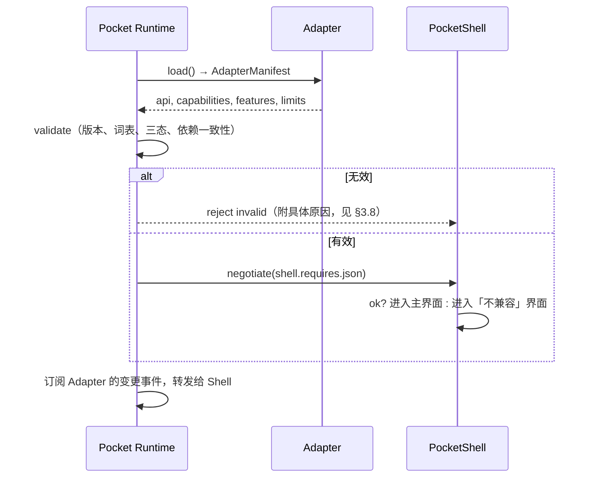

# 04 — Capability 与 Feature 模型

> 阶段一交付物。本文定义两层「平台能做什么」的表达格式、查询流程、缺失降级，以及与 PocketJS 既有 capability 词表的映射。
>
> 上游依据：issue #104「Capability 回答有没有（wifi/bluetooth/touch/vibration/hdmi），Feature 回答能干什么（bt_sink/bt_source/audio_hw_volume/display_rotation/suspend/rtc_alarm）。PocketShell 不允许推断，必须查询。」
>
> 审计依据：[01-audit.md](01-audit.md)。接口签名：[03-platform-api.md](03-platform-api.md)。

---

## 1. 两层模型

```
Capability  ── 有没有这块硬件/这条链路        wifi, bluetooth, touch, vibration, hdmi
    ▲                                        （一次性、静态、设备级）
    │ 可被 Feature 依赖（单向）
Feature     ── 这条链路能做什么具体的事       bt_sink, bt_source, audio_hw_volume,
                                             display_rotation, suspend, rtc_alarm
```

三条不可违反的规则：

| # | 规则 | 反面例子（来自审计） |
|---|---|---|
| N1 | Capability 是**三态**（`yes`/`no`/`unknown`）；`unknown` 不等于 `no` | 今天无背光节点时返回字符串 `"unknown"`（`RNX scripts/pocketshell-launcher.rs:16`），而「读到了但解析失败」也走同一条 `"unknown".into()` 出口（`:6-17`），Shell 无法区分 |
| N2 | Feature **可以**依赖 Capability 或另一个 Feature，但依赖图必须**无环**；依赖方向只能是 Feature → Feature / Feature → Capability，Capability **绝不**依赖任何 Feature | — |
| N3 | Shell **不得**从 Capability 推 Feature，也不得从 Feature 推 Capability | 今天 Shell 拿到 `LEVEL\twifi === "on"` 就假设能显示 IP —— 实际两者由不同来源决定（`PKT/.../pocketshell_launcher.rs:223-249`） |

---

## 2. Capability 词表

命名规则：`<域>.<对象>`，全小写，点分；**不出现硬件型号、芯片名、路径、单元名**。

### 2.1 基础能力（issue 明确列出的五个 + 审计要求补充的）

| id | 含义 | 今天 Shell 怎么得到它 | 备注 |
|---|---|---|---|
| `wifi` | 有无线网络硬件 | 无（状态栏固定画图标） | 与 `BASEOS_WIFI`（`PJOS build-rootfs.sh:129`）、Rocknix `wifi.enabled` 对应 |
| `bluetooth` | 有蓝牙硬件 | 无 | |
| `touch` | 有触摸屏 | profile 里声明 `input.touch`（`PKT/profiles/*.ts`） | 见 §5 映射 |
| `vibration` | 有振动马达 | 无 | 今天任何平台都没声明 |
| `hdmi` | 有外部显示输出 | `docs/06-status-and-lessons.md:18`（RG40XX V 上验证过双向热插拔） | |
| `battery` | 有电量计 | 无（读 `/sys/class/power_supply`，失败给 `"unknown"`） | `PKT/.../pocketshell_launcher.rs:201-221` |
| `audio.output` | 有音频输出 | 无（`LEVEL\tvolume` 靠 `amixer`/`pactl` 探测） | `launcher.rs:18-24` |
| `display.brightness` | 有可调背光 | 无（读 `/sys/class/backlight`） | `launcher.rs:7` |
| `input.buttons` | 有实体按键/手柄 | profile 声明 | |
| `input.pointer` | 有绝对指针（鼠标/触控板） | 无 | |
| `input.keyboard` | 有硬件文本输入 | 无 | |
| `storage.user_content` | 有用户内容区（可被 Library 扫描） | 无（直接扫 `/storage/docs` 等） | `pocketshell-library.rs:7` |
| `power.management` | 能做电源状态转换 | 无 | 与 Feature `suspend` 区分：能转换 ≠ 支持某种转换 |
| `rtc` | 有实时时钟 | `PJOS devices.json` 无此字段 | |
| `led` | 有可控指示灯 | 无（`baseos-charger` 写 `work_led`，`PJOS overlay/usr/sbin/baseos-charger:64`） | |

### 2.2 三态判定表（Adapter 实现时必须逐条给出）

| 输入 | 输出 |
|---|---|
| 硬件枚举到，驱动就绪 | `yes` |
| 硬件**确定**不存在（BSP 声明 / 设备树无节点 / 编译期排除） | `no` |
| 硬件可能存在，但平台无法判定（节点缺失且无声明、查询失败、非 root 无法读） | `unknown` |

**禁止**用「查询失败」当 `no`。这是今天最典型的错误：把「我读不到」当成「没有」。实践中两者的用户可见后果完全不同——`no` 应当隐藏 UI 入口，`unknown` 应当显示入口但标注「不可用/未确认」。

### 2.3 表达格式（wire）

Capability 在 Adapter 自报的 manifest 里是一张 map，值恒为三态字符串：

```json
{
  "capabilities": {
    "wifi": "yes",
    "bluetooth": "yes",
    "touch": "no",
    "vibration": "unknown",
    "hdmi": "no",
    "battery": "yes",
    "audio.output": "yes",
    "display.brightness": "yes",
    "input.buttons": "yes",
    "input.pointer": "no",
    "input.keyboard": "no",
    "storage.user_content": "yes",
    "power.management": "yes",
    "rtc": "yes",
    "led": "yes"
  }
}
```

约束：

1. **未列出的键视为 `unknown`**，不是 `no`。这样旧 Adapter 不必一次性补全。
2. **未知键必须被 Runtime 接受并原样传递**（前向兼容），但 Shell 侧的 `capability.get()` 对未注册 id 返回 `invalid` 错误，防止拼写错误静默通过。
3. 值只允许三个字符串字面量；其他（`true`/`1`/`"YES"`/`null`）使整个 manifest 无效（`invalid`），拒绝加载该 Adapter。这条比宽松解析重要：静默修正会掩盖 Adapter 的 bug。

---

## 3. Feature 词表

命名规则：`<域>.<动作>`，全小写，点分。

### 3.1 呈现

| id | 含义 | 依赖 | 今天的位置 |
|---|---|---|---|
| `display.rotation` | 能在运行时改变屏幕朝向 | `power.management`（旋转是一次显示电源模式切换） | `PJOS docs/15` §5.1 的 `panel.rotation_ccw` 是**构建期**事实，应用拿不到 |
| `display.hw_brightness` | 亮度由硬件寄存器控制（而非软件 gamma 模拟） | `display.brightness` | 无 |
| `display.external_output` | 能切换/热插拔外部显示 | `hdmi` | `docs/06-status-and-lessons.md:18` 的人工验证 |

### 3.2 音频

| id | 含义 | 依赖 |
|---|---|---|
| `audio.hw_volume` | 音量由硬件混音器控制（改了对所有输出生效） | `audio.output` |
| `audio.routing` | 能在输出之间切换（耳机/蓝牙/HDMI） | `audio.output` |
| `bluetooth.sink` | 能作为蓝牙音频**接收端**（手机连过来听） | `bluetooth` |
| `bluetooth.source` | 能作为蓝牙音频**发送端**（连耳机/音箱） | `bluetooth` |

`bluetooth.sink` / `bluetooth.source` 是 issue 里 `bt_sink` / `bt_source` 的规范化命名（保留域前缀，避免与未来的 `usb.sink` 混淆）。

### 3.3 电源

| id | 含义 | 依赖 |
|---|---|---|
| `power.suspend` | 能进入睡眠并唤醒 | `power.management` |
| `power.rtc_alarm` | 能用 RTC 定时唤醒 | `rtc` + `power.suspend` |
| `power.shutdown` | 能软关机 | `power.management` |
| `power.reboot` | 能软重启 | `power.management` |
| `power.battery_saver` | 有硬件/内核级的节能档 | `battery` |

### 3.4 输入

| id | 含义 | 依赖 |
|---|---|---|
| `input.osk` | 平台提供屏幕键盘（Shell 不必自绘） | 无（与 `touch` 无必然关系：手柄也能操作 OSK） |
| `input.ime` | 平台提供输入法（组合/候选） | `input.osk` |
| `input.haptics` | 能用振动做反馈 | `vibration` |

### 3.5 网络

| id | 含义 | 依赖 |
|---|---|---|
| `network.wifi_scan` | 能扫描周边网络 | `wifi` |
| `network.wifi_join` | 能加入网络（含口令） | `wifi` |
| `network.bluetooth_pair` | 能配对/管理蓝牙设备 | `bluetooth` |

### 3.6 状态

| id | 含义 | 依赖 |
|---|---|---|
| `status.battery_detail` | 能给出温度/健康度/剩余时间（不只是百分比） | `battery` |
| `status.wifi_signal` | 能给出信号强度 | `wifi` |

### 3.7 表达格式（wire）

```json
{
  "features": {
    "display.rotation": "supported",
    "display.hw_brightness": "unsupported",
    "audio.hw_volume": "supported",
    "audio.routing": "supported",
    "bluetooth.sink": "unsupported",
    "bluetooth.source": "supported",
    "power.suspend": "supported",
    "power.rtc_alarm": "unknown",
    "input.osk": "supported",
    "input.ime": "unsupported",
    "input.haptics": "unsupported",
    "network.wifi_scan": "supported",
    "network.wifi_join": "supported",
    "network.bluetooth_pair": "supported",
    "status.battery_detail": "unsupported",
    "status.wifi_signal": "supported"
  }
}
```

值恒为 `"supported"` / `"unsupported"` / `"unknown"`。未列出的键视为 `unknown`。

### 3.8 一致性校验（Runtime 强制，Adapter 加载时执行一次）

对每个 `feature`，按依赖图自底向上求值（Feature→Feature 依赖先算，再算 Feature→Capability）：

| 条件 | 结果 |
|---|---|
| 依赖了**未注册**的 Capability 或 Feature | **manifest 无效**：`invalid`，拒绝加载（拼写错误，或词表版本不匹配） |
| 依赖图**有环** | **manifest 无效**：`invalid`，拒绝加载 |
| 任一 Capability 依赖为 `"no"` | **manifest 无效**：`invalid`，拒绝加载（这是 Adapter 的 bug） |
| 任一 Capability 依赖为 `"unknown"` | 该 feature 必须为 `"unknown"`；若 Adapter 声称 `"supported"` 则**降级为 `unknown`** 并记一条诊断 |
| 任一 Feature 依赖不为 `"supported"` | 该 feature 必须为 `"unsupported"`（依赖的 feature 不可用，依赖者也不可用）；若声称 `"supported"` 则**降级**，并记一条诊断 |
| 所有依赖均为 `"yes"` / `"supported"` | 合法：保留 Adapter 自报的值（可以是 `"supported"` 或 `"unsupported"`） |
| feature 未声明依赖 | 视为依赖空集，合法（但词表里每个 feature 都已定义依赖） |

两点说明：

1. **Capability 为 `no` 时拒绝加载**，因为那只可能是 Adapter 写错了；而 Capability 为 `unknown` 时只降级，因为 `unknown` 是平台诚实的回答，拒绝会让用户什么也看不到。
2. **Feature 依赖不满足时只降级、不拒绝**：同一份 Adapter 在不同设备上可以有 `input.osk=unsupported`，那么 `input.ime` 自然也 `unsupported`，这是合法配置而非 bug。

---

## 4. 查询流程

### 4.1 启动序（一次）



### 4.2 运行期（订阅）

| 事件 | 触发者 | Shell 必须做什么 |
|---|---|---|
| Capability 由 `yes` → `no` | Adapter（例如 USB 无线网卡拔出） | 立即隐藏相关入口；正在进行的操作以 `unavailable` 结束 |
| Capability 由 `unknown` → `yes`/`no` | Adapter（平台终于能判定） | 重新评估入口可见性 |
| Capability 由 `no` → `yes` | Adapter | 显示入口（不自动执行任何操作） |
| Feature 变化 | 同上 | 同上；**已在进行的操作不因 feature 变 unsupported 而中断**，但要提示结果可能不完整 |

**禁止**：Shell 在收到变更后主动「探测一下」。所有判定必须来自事件与 `snapshot()`。

### 4.3 缓存规则

| 层 | 缓存什么 | 失效 |
|---|---|---|
| Runtime | 每个 Adapter 的 manifest（静态） | Adapter 重载 |
| Runtime | Capability/Feature 当前值 | Adapter 推事件 |
| Shell | `negotiate()` 结果 | 永不（进程生命周期） |
| Shell | `snapshot()` 的 UI 派生状态 | 订阅回调 |

Capability/Feature 查询**不设超时缓存**：它们的来源是 Adapter 启动时建好的内存索引，不是设备查询。这把它与 Battery/Audio/Network 的「读数」区分开——后者必须容忍 stale。

---

## 5. 与 PocketJS capability 词表的映射

PocketJS 的词表在 `PKT/contracts/spec/platform-types.ts:155-280`（30 个 id），并且是 **admission 的硬约束**：manifest 的 `engine.capabilities.requires` 必须是 profile `capabilities` 的子集（`PKT/framework/src/manifest/resolve.ts:542-605`）。

因此本模型**不试图取代**它，而是明确两层关系：

| 我们的 Capability/Feature | PocketJS capability id | 方向 |
|---|---|---|
| `input.buttons` | `input.buttons` | 同名，Adapter 必须同时声明 |
| `touch` | `input.touch` | 我们的名字短，映射到 PocketJS 的全名 |
| `input.pointer` | `input.pointer` | 同名 |
| `input.keyboard` | `input.text` | 我们的 `keyboard` = 有硬件文本流 |
| Feature `input.ime` | `input.ime` | 同名 |
| Feature `input.osk` | 无对应（PocketJS 的 OSK 在 `framework/src/osk.tsx`，是 guest 自己画的） | 我们的 Feature 表示「平台代画」 |
| `audio.output` + Feature `audio.hw_volume` | `audio.pcm` **不映射** | `audio.pcm` 是 guest 播放能力，与本层无关 |
| `storage.user_content` | `data.fs` **不映射** | `data.fs` 是应用沙箱内的文件树 |
| `wifi` + Feature `network.wifi_*` | `system.wifi` | 我们的拆分更细（有没有 vs 能扫 vs 能连） |
| `bluetooth` + Feature `bluetooth.*` | **无对应** | PocketJS 没有蓝牙能力 id |
| `display.brightness` | **无对应** | PocketJS 没有背光能力 id |
| `battery` | **无对应** | 同上（审计已确认：`grep battery` 在 `framework/src` 与 `contracts/spec` 零命中） |
| `vibration` / Feature `input.haptics` | **无对应** | |
| `hdmi` / Feature `display.external_output` | `display.auxiliary` **不映射** | `display.auxiliary` 是「同实例第二块固定视口」，不是热插拔 HDMI |
| Feature `display.rotation` | 无对应 | profile 的 `presentations`/`display` 是构建期事实 |
| Feature `power.*` | 无对应 | |

**映射表的实现位置**：`pocket-platform-api` 提供一个纯函数表（数据），由 Adapter 在导出 profile 时使用：

```ts
/** 我们的能力 → PocketJS 能力 id 列表（一个能力可能对应多个上游 id）。 */
export const CAPABILITY_TO_POCKETJS: Readonly<Record<string, readonly string[]>>;
```

规则：

1. **单向**：只从我们的模型生成 PocketJS profile 的 `capabilities`，不反向解析。
2. **未知不映射**：`unknown` 的 Capability **不加入** profile 的 `capabilities`（否则 admission 会允许一个并不存在的 API，Shell 用的时候才崩）。
3. **`unknown` 与 `no` 在 profile 上不可区分**——这是 PocketJS 词表的限制（它不是三态）。因此：**PocketJS profile 只能表达「确定有」，三态只活在 Platform API 层**。这条限制必须写进 Adapter 契约，否则 Adapter 作者会以为 profile 能承载 `unknown`。

### 5.1 一个具体的矛盾，必须由用户拍板

今天 `rocknix-h700-kms` profile 的 `capabilities` 只有两项：`["input.buttons", "text.glyphs.baked"]`（`RNX .../pocketjs-runtime/config/profile.ts:14`）。但 `programs/linux-kms/pocket.runtime-config.ts:9` 的 `LINUX_PROGRAM_CAPABILITIES` 允许四项（多了 `input.pointer`/`input.touch`），而 evdev 后端实际能交付 `BUTTONS|POINTER|CONTACT`（`PKT/programs/linux-kms/src/main.rs:21-23`）。

也就是说：**平台实际有能力，但 profile 没声明，所以 Shell 用不上**。这不是安全，这是漏配。新模型下 Adapter 必须从「平台上实际能交付什么」生成两条声明（我们的三态 + PocketJS 的 requires 子集），并且两者必须能被一条测试核对（见 [07](07-mock-and-tests.md) §4）。

---

## 6. 缺失降级

### 6.1 三个层次

| 层 | 缺失时 | 谁决定 |
|---|---|---|
| **协商期**（启动） | `requiresCapabilities` 里 `no` → 不启动，显示明确原因 | Shell |
| **功能期**（进入某功能） | `requiresFeatures` 里非 `supported` → 入口隐藏/禁用 | Shell |
| **操作期**（点击后） | 返回 `unsupported`/`unavailable` → 就地提示，不改变入口可见性 | Shell |

三层都必须有**可见反馈**。禁止静默 no-op。

### 6.2 具体降级表（Shell 侧必须实现的形态）

| 缺失项 | UI 行为 | 今天的行为（对照） |
|---|---|---|
| `display.brightness` = `no` | 设置页不显示亮度行 | 显示亮度行，值 `unknown`，点 +/− 后无反应（`launcher.rs:37-45` → `heya-control` 不存在） |
| `audio.output` = `no` | 不显示音量行 | 显示，`amixer`/`pactl` 都失败 → `unknown` |
| `battery` = `no` | 状态栏不画电量 | 画电量，值 `--`（`status-bar.tsx` 的 `batteryKnown()` 分支） |
| `battery` = `unknown` | 画图标 + 灰显，长按显示「平台未确认」 | 无法表达 |
| `wifi` = `no` | 不画 Wi-Fi 图标、不显示 IP | 画 `--` |
| `wifi` = `yes` 但 `network.wifi_join` = `unsupported` | 显示状态、隐藏「连接」入口 | 无此区分 |
| `bluetooth.sink` = `unsupported` | 设置页不显示「音频接收」 | 无此功能 |
| `power.suspend` = `unsupported` | 设置页不显示休眠时长 | 有 `SLEEP` 项，写入后守护进程不存在 |
| `power.rtc_alarm` = `unsupported` | 不显示闹钟 | 无 |
| `input.osk` = `unsupported` | 使用 Shell 自带键盘 | **今天总是**用自带键盘（`hello/main.tsx` 内建 6 标签输入面板） |
| `input.haptics` = `unsupported` | 不调用 `feedback` | 无 |
| `storage.user_content` = `no` | Library 显示「本平台无内容区」 | 扫 `/storage/docs` → 空列表，无解释 |

### 6.3 降级的两个反模式（明确禁止）

| 反模式 | 为什么禁止 | 审计里的例子 |
|---|---|---|
| **试一下，失败就藏起来**（try-and-hide） | 用户看不到「为什么没有」，也无法区分「平台不支持」与「暂时坏了」 | `frontend-session` 按文件名挑前端（`PJOS overlay/usr/sbin/frontend-session:164-183`）：找不到就显示「ADD FRONTEND TO SD CARD」，无法说明缺的是哪个版本 |
| **显示假值占位** | 用户会以为是设备坏了 | `LEVEL\tbattery` 失败返回 `"unknown"` → Shell 解析失败 → 状态栏 `--`（`PKT/.../pocketshell_launcher.rs:221`） |

正确的第三种：**显示入口 + 明确原因 + 可操作建议**（例如「本平台未确认蓝牙，设置项已隐藏」写在设置页底部，而不是把整行藏掉不留痕）。这是 `pocket-settings` 已经在做的形态：`{available, available:false, reason}`（`apps/pocket-settings/backend/settingsd/main.go:44-49`、`:523`）。

---

## 7. 变更管理

| 变更 | 需要什么 | 不需要什么 |
|---|---|---|
| 新增一个 Capability id | API 仓加词表条目 + 依赖声明；Adapter 可选声明 | 不升 `api`；不改 Shell（除非要用） |
| 新增一个 Feature id | 同上 | 不升 `api` |
| 删除/改名一个 id | **必须**升 `api` 主版本 | — |
| 把某 Feature 从 `unsupported` 改成 `supported`（某 Adapter） | 该 Adapter 的 manifest + 真机证据 | 不改任何其他仓 |
| 收紧 `limits` 某值 | Adapter manifest | 不改 Shell（Shell 必须按 `limits` 自适应） |

**词表版本化**：API 仓的 `capabilities.ts` / `features.ts` 是**唯一**来源；Adapter 不得自定义 id。Runtime 对未注册 id 记 `invalid` 并拒绝加载 manifest——这条比「容忍未知键」更严格，是为了防止 Adapter 之间出现方言（今天已有：`pocket-launcher` 的 7 个能力、`pocket-settings` 的 16 个、`pjos-keyboard` 的 4 个，三套互不相通）。

---

## 8. 待定

| id | 问题 |
|---|---|
| C1 | `led` 是否需要独立的 Feature（`led.brightness`）还是只作 Capability |
| C2 | `vibration` 是否需要细分为 `vibration.motor` / `vibration.haptic_engine` |
| C3 | Feature `bluetooth.sink`/`source` 是否应合并为 `bluetooth.audio_role: "sink" \| "source" \| "both"`（更表达事实，但削弱「三态」一致性） |
| C4 | `network.wifi_join` 是否要按安全类型细分（WPA2/WPA3/企业）——企业认证需要额外域 |
