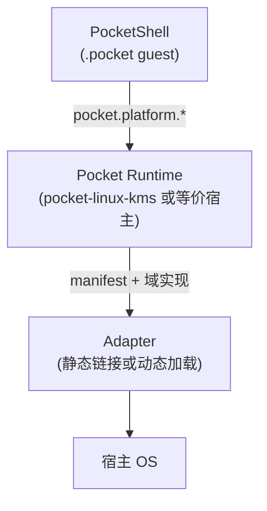
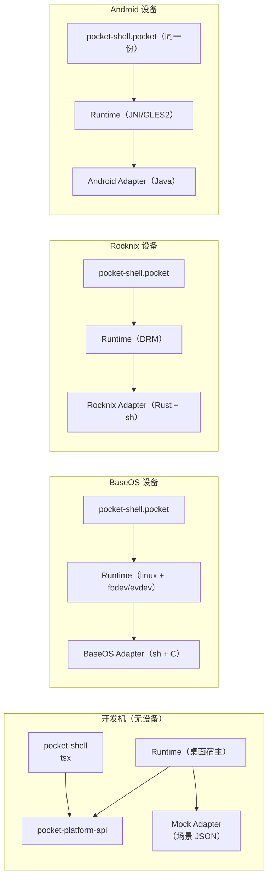
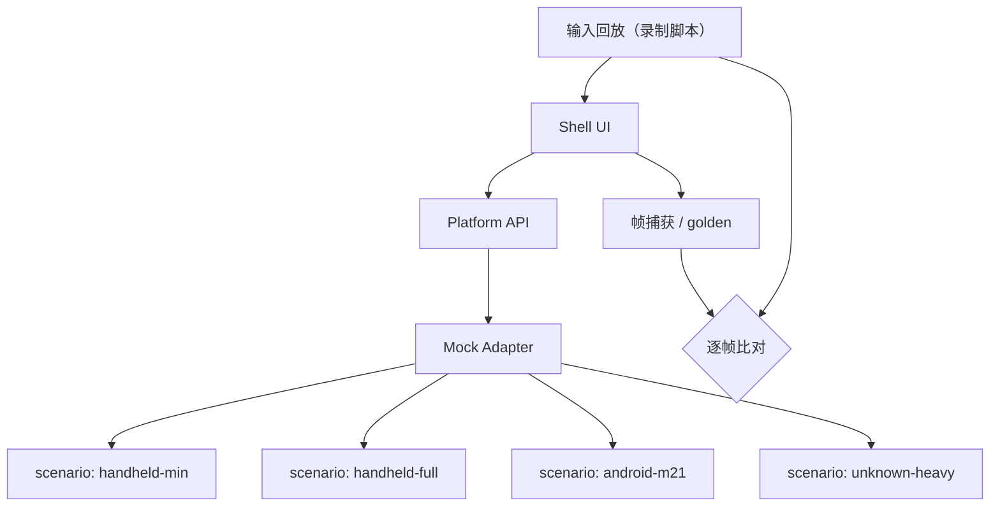

# 05 — Adapter 模式设计

> 阶段一交付物。本文定义 Adapter 的共同契约、三份具体契约（BaseOS / Rocknix / Android）、最小组网图，以及「Adapter 不实现」时的正确形态。
>
> 前提：[02](02-repo-boundaries.md) 定的单向依赖；[03](03-platform-api.md) 的九个域签名；[04](04-capability-feature.md) 的三态与依赖规则。

---

## 1. Adapter 是什么，不是什么

**是**：一个**进程内**（或同进程的另一线程）的库，把宿主 OS 的机制翻译成 Platform API 的域方法。它由 Runtime 加载，生命周期由 Runtime 管理。

**不是**：

- 不是代理进程（不引入第二条 IPC 通道）。今天的教训：Shell 已经通过三条字符串桥 + 一个 HTTP 输入服务 + 三个 systemd 单元在多跳通信，再加一层只会更糟。
- 不是「按平台分支的 if」的集合。Adapter 是**被选中的实现**，不是被判断的分支。
- 不是 Shell 的插件。Shell 不得知道 Adapter 存在，也不得加载/枚举它。

### 1.1 加载模型



| 项 | 规则 |
|---|---|
| 选择 | **由构建决定**。一个 Runtime 二进制内嵌一个 Adapter（便于静态链接、ABI 对齐）；同一 Runtime 源码可按 feature 编入多个 Adapter，但运行时**只激活一个**（由启动参数选择，不是自动探测）。 |
| 数量 | 一次只激活一个。理由：多 Adapter 会让「谁回答 `battery`」变成需要仲裁的问题；真实场景（一台设备一个 OS）不需要。 |
| 重载 | 不支持。Adapter 加载失败 → Runtime 报明确错误并退出（不进入「半可用」状态）。 |
| 隔离 | Adapter 崩溃 = Runtime 崩溃。这是可接受的：Runtime 崩了 Shell 也活不了；关键是**崩溃信息要能定位到 Adapter**。 |

**为什么是「构建决定」而非「运行探测」**：运行探测（找 `/dev/dri`、找 `H700 Gamepad`、试 `amixer`）正是今天所有问题的根源（[01](01-audit.md) §2）。构建期选定 = 无歧义。

---

## 2. 共同契约

### 2.1 AdapterManifest

```ts
export interface AdapterManifest {
  /** Platform API 主版本。必须与 Runtime 支持的版本相等。 */
  readonly api: number;
  /** 诊断用标签（如 "baseos-h700"）。Shell 类型上不可见。 */
  readonly adapter: string;
  /** 人读的描述，仅用于日志与崩溃报告。 */
  readonly description: string;
  readonly capabilities: Readonly<Record<string, TriState>>;
  readonly features: Readonly<Record<string, FeatureState>>;
  readonly limits: Limits;
  /** Adapter 自己声明的 profile（PocketJS 七字段），供 runtime 导出。 */
  readonly pocketProfile?: PocketProfileJson;
}
```

Runtime 加载时执行（顺序固定，遇错即停）：

| # | 检查 | 失败码 |
|---|---|---|
| 1 | `api` 与 Runtime 主版本相等 | `version` |
| 2 | `capabilities` 的键都在 API 词表内，值都是三态字面量 | `invalid` |
| 3 | `features` 的键都在 API 词表内，值都是 Feature 三态字面量 | `invalid` |
| 4 | 每个 feature 的依赖（Capability 与 Feature）都已注册、依赖图无环；Capability 为 `no` 时拒绝；依赖不满足时降级 | `invalid` / 降级（见 04 §3.8） |
| 5 | `limits` 各字段为正整数（`maxTextSessions` 允许 ≥1） | `invalid` |
| 6 | 若给了 `pocketProfile`：通过 PocketJS 的 `validatePocketProfile`，且其 `capabilities` ⊆ 映射表从我们的 Capability 生成的集合 | `invalid` |

第 6 项是把 [04](04-capability-feature.md) §5 的映射变成**可执行约束**，而不是文档约定。

### 2.2 必须实现 vs 可拒绝

[03](03-platform-api.md) §4.1 已给矩阵。Adapter 侧记法：

- **MUST**：必须实现且不得拒绝 `unsupported`（`display.info`、`input.facts`、`storage.collections`、`storage.writeAppFile` 系列、`capability.*`、`feature.*`）。
- **MAY**：可以恒拒绝 `unsupported`（其余全部）。

一个「全 MUST + 其余 unsupported」的最小 Adapter 是**合法**的，并且必须在 console 上能跑起来（无亮度、无音频、无电池、无网络）。这是 Android Adapter 第一阶段的目标形态（见 §5）。

### 2.3 线程与重入

| 规则 | 理由 |
|---|---|
| 域方法在**非渲染线程**执行（Runtime 提供执行器） | 今天 Shell 桥在 guest 渲染线程上 fork 子进程，被迫用 `timeout 2`（`PKT/.../pocketshell_launcher.rs:3-19`） |
| 同一 Adapter 实例上的调用可并发；Adapter 必须自己保证内部状态一致 | 避免「一个慢查询卡住所有域」 |
| 事件回调由 Runtime 的帧边界投递，不在 Adapter 线程里直接调 Shell | 保证 Shell 的响应式系统只在一个线程上运行 |
| `snapshot()` 必须无锁且恒速（读一次原子快照） | 它会在每帧被调用 |

### 2.4 事件

```ts
export interface AdapterEvents {
  capabilities?(changes: Readonly<Record<string, TriState>>): void;
  features?(changes: Readonly<Record<string, FeatureState>>): void;
  display?(info: DisplayInfo): void;
  input?(facts: InputFacts): void;
  audio?(state: AudioState): void;
  battery?(status: BatteryStatus): void;
  network?(state: { wifi: WifiState; bluetooth: BluetoothState }): void;
  sleep?(state: { asleep: boolean; reason: SleepReason | null }): void;
}
```

- Runtime 负责**去抖**：同一域的变更在一帧内合并成一次投递。
- Runtime 负责**背压**：Adapter 可以在 Shell 处理不过来时丢弃中间值（只保留最新），因为这些都是「状态」而非「事件流」。
- **禁止** Adapter 直接持有 Shell 的引用。

---

## 3. BaseOS Adapter 契约

### 3.1 宿主事实（可用的原料）

| 事实 | 位置 | 备注 |
|---|---|---|
| 设备身份 | `/etc/baseos-release`（由 `PJOS build-rootfs.sh:117-130` 生成） | 含 `BASEOS_PLATFORM`、`BASEOS_TARGET`、`BASEOS_MODEL`、`BASEOS_PANEL_ROTATION_CCW`、`BASEOS_WIFI`、`BASEOS_BLUETOOTH` |
| 启动入口 | `overlay/etc/inittab:4` → `overlay/usr/sbin/frontend-session` | busybox init，**无 systemd** |
| 显示 | `/dev/fb0`（`docs/13` 实测：无 `/dev/dri`） | fbdev 路径 |
| 输入 | `/dev/input/event*`（`docs/13` 实测 `event1 = ANBERNIC-keys`） | evdev |
| 亮度 | `docs/13` 实测：无 `/sys/class/backlight`；有 `/sys/class/disp/disp/attr` | **节点未确认**，Adapter 必须诚实回答 |
| 电量 | `/sys/class/power_supply/axp2202-battery/`（`PJOS overlay/usr/sbin/baseos-charger:64`、`overlay/etc/init.d/rcS:11`） | 型号进节点名，但**只在 Adapter 里** |
| 音量 | `amixer`（`docs/13` 实测存在） | |
| 无线 | `wpa_cli` / `bluetoothctl`（`docs/13` 实测存在）；`systemctl` shim 只覆盖 bluetooth（`overlay/usr/sbin/systemctl:1-9`） | |
| 键盘 | `runtime/keyboardd`（Go，loopback `127.0.0.1:8787`） | |
| 电源动作 | `overlay/usr/sbin/poweroff`、`reboot`、`baseos-poweroff`、`baseos-reboot` | |
| 休眠 | 写 `/sys/power/state` = `mem`（`docs/05-runtime-power-network.md` §2） | |
| 内容区 | `/mnt/sdcard`（活跃前端卡）；`docs/13` 实测 p7 vfat 扩到 28G | 与 Rocknix 的 `/storage` **不同** |

### 3.2 契约表

| 域 | BaseOS 实现 | Capability/Feature 声明 |
|---|---|---|
| Display | `info` ← framebuffer 几何（`/sys/class/graphics/fb0/virtual_size`、`bits_per_pixel`，`PJOS overlay/usr/sbin/baseos-diag:532` 已用过同一对文件）；`setBrightness` ← `/sys/class/disp/disp/attr/enhance_bright`（**待真机确认**）或拒绝 `unsupported` | `display.brightness`: `unknown`（未确认）直到实测；`display.rotation`: 若 `BASEOS_PANEL_ROTATION_CCW != 0` 则 `supported`，否则 `unsupported` |
| Input | `facts` ← evdev 类（buttons/pointer/contact）；`openTextSession` ← keyboardd HTTP（翻译成 `show/focus/key/submit` 调用，见 §3.3）；`feedback`: `unsupported` | `input.osk`: `supported`（keyboardd stub provider）；`input.ime`: `unsupported`（`docs/16` 明示 Phase 1 无输入法）；`input.haptics`: `unsupported`（`devices.json` 无 vibration 字段） |
| Audio | `state` ← `amixer get Master` 解析；`setVolume` ← `amixer set Master N%`；`output` 路由：`unsupported` | `audio.output`: `yes`；`audio.hw_volume`: `supported`；`audio.routing`: `unsupported` |
| Storage | `collections` ← 卡上内容目录（`documents`/`books`/`reports`/`music`）；`writeAppFile` ← 前端私有目录（例如 `<card>/System/.state/`） | `storage.user_content`: `yes`（有卡时）/ `no`（无卡） |
| Battery | `status` ← `/sys/class/power_supply/axp2202-battery/{capacity,status}`；`temperatureC`/`healthPercent`: `null` | `battery`: `yes`；`status.battery_detail`: `unsupported` |
| Power | `idlePolicy`/`setIdlePolicy` ← 取代 `pocketjs-sleep` 守护（读输入 + 写背光）；`suspend` ← `/sys/power/state` = `mem`；`shutdown`/`reboot` ← `baseos-poweroff`/`baseos-reboot`；`setAlarm` ← RTC（`/sys/class/rtc/rtc0/since_epoch`，`PJOS overlay/usr/sbin/baseos-charger:19` 已用） | `power.suspend`: `supported`（`docs/06-status-and-lessons.md:13` 在 RG40XX V 上验证过 Suspend-to-RAM）；`power.rtc_alarm`: `unknown`；`power.shutdown`/`reboot`: `supported` |
| Network | `wifiState` ← `wpa_cli status`；`setWifiEnabled` ← `wpa_cli` + ip link；`scanWifi`/`joinWifi` ← `wpa_cli scan/scan_results/add_network`；`bluetoothState` ← `bluetoothctl show` + `pidof bluetoothd` | `wifi` ← `BASEOS_WIFI`；`bluetooth` ← `BASEOS_BLUETOOTH`；`network.wifi_scan`/`join`: `supported`（wpa_cli 可用）；`network.bluetooth_pair`: `unsupported`（Phase 1：只暴露开关） |
| Capability/Feature | 由 `/etc/baseos-release` + 探测（**仅限 Adapter 内部**）在启动时生成 | — |

### 3.3 keyboardd 的翻译边界

今天 keyboardd 的 Input API 是 HTTP+JSON（`PJOS runtime/keyboardd/` 与 `docs/16`）。Adapter 的 `openTextSession` 必须把它包成**一次会话**：

| Platform API | keyboardd 调用 | 依据 |
|---|---|---|
| `openTextSession({layout,value,secure,fieldId})` | `POST /api/keyboard/focus {inputId: fieldId, layout, value}`（或 `show` 当无 fieldId） | `docs/16` 表；`POST /api/keyboard/focus` 自动 show |
| 会话内 Shell 侧无操作 | provider 推 key，keyboardd 合成值 | `docs/16`「Apps never render a keyboard」 |
| `handle.submit()` | `POST /api/keyboard/submit {}` → `{value}` | 同上 |
| `handle.cancel()` | `POST /api/keyboard/hide` → value 取进入前的值 | 同上 |
| `platform.input.facts().ime` | 恒 `false`（Phase 1 无输入法） | `docs/16`「Phase 1 implements no input methods」 |
| 布局 `number` + `secure` | `layout: "number", secure: true` | `docs/16`「`number` is the canonical layout for passwords/PINs」 |

**降级**：keyboardd 不可达时，`openTextSession` 立即拒绝 `unsupported`（**不是** `unavailable`）——因为 Shell 需要在启动时就决定「我要不要画自己的键盘」。这把 `pjos-input-framework/docs/INTEGRATION-CONTRACT.md:118-122` 的「keyboardd unreachable → 保持现状不阻塞 UI」从应用侧责任提升为平台契约。

### 3.4 与 `frontend-session` 的关系

BaseOS Adapter 需要一个新的启动形态（设计，不实现）：

| 今天 | 目标 |
|---|---|
| `inittab` respawn `frontend-session`，脚本按**文件名**找前端并 `exec ld-linux`（`overlay/usr/sbin/frontend-session:245`） | `frontend-session` 只做「准备 → 启动 Runtime（带 BaseOS Adapter）→ 由 Runtime 加载 Shell 包」 |
| BaseOS 私有工具（`baseos-splash`、`baseos-diag`、`baseos-update`）与前端无契约 | 同上；它们继续由 BaseOS 负责，不进 Platform API |
| `BASEOS_*` 环境变量灌给前端进程（`:7-11`） | 不再灌给 Shell；Adapter 自己读 `/etc/baseos-release` |

**这一条对「零行为变化」最危险**（见 [08](08-migration.md) M3）：`BASEOS_*` 今天会出现在前端环境里，现有前端（含 NextUI 的脚本）可能依赖它。迁移时必须保留 env 注入直到确认无人使用。

---

## 4. Rocknix Adapter 契约

### 4.1 宿主事实

| 事实 | 位置 |
|---|---|
| 服务管理 | systemd（`pocketjs-kms.service` 等，`RNX .../system.d/`） |
| 显示 | DRM/KMS，`/dev/dri/card*`，探测 connector `connected`（`scripts/pocketjs-session:16-27`） |
| 输入 | `/dev/input/event*`；H700 手柄走 legacy joystick `/dev/input/js*`（`scripts/rocknix-hotkeys:12-16`） |
| 亮度 | `/sys/class/backlight/*`（`launcher.rs:7`） |
| 电量 | `/sys/class/power_supply/*`（`PKT/...:201-221`） |
| 音量 | `amixer` / `pactl`（`launcher.rs:18-24`） |
| 服务开关 | `rocknix-services {list,status,start,stop,toggle,set}`（`RNX projects/ROCKNIX/packages/rocknix/sources/scripts/rocknix-services:22`） |
| 音量/亮度/无线写 | `heya-control` 的 `volume` / `brightness` / `wifi` / `bluetooth` 四个子命令（`RNX projects/ROCKNIX/packages/apps/heya/scripts/heya-control:8-37`） |
| 内容区 | `/storage/*`，`/storage/roms` 等（`RNX docs/platform-audit.md` 的路径表） |
| 休眠/背光 | `pocketjs-sleep`（Python） |
| 应用启动 | `pocketjs-native-launch` → `/usr/bin/heya-tool`、`/usr/bin/disk-browser`、`/usr/bin/xmplayer` + `pocket-session-run`（`systemd-run`） |

### 4.2 契约表

| 域 | Rocknix 实现 | Capability/Feature |
|---|---|---|
| Display | `info` ← DRM connector mode（取代 `PKT/...:98-113` 的 fb0/drm 混读）；`setBrightness` ← `/sys/class/backlight` | `display.brightness`: `yes`（有节点时）；`display.rotation`: 依面板声明（`docs/15` §5.1 建议进 profile） |
| Input | `facts` ← evdev 类 + `H700 Gamepad` 是否存在（**仅在 Adapter 内**）；`openTextSession`: `unsupported`（Rocknix 上键盘是 Shell 自绘） | `input.osk`: `unsupported`；`input.haptics`: 依板 |
| Audio | `state` ← `amixer`/`pactl`；`setVolume` ← `heya-control volume`（复用既有实现，不重写） | `audio.hw_volume`: `supported`；`audio.routing`: 依设备 |
| Storage | `collections` ← `/storage/{docs,books,reports,music,videos}`；`writeAppFile` ← `/storage/pocketshell/<app>` | `storage.user_content`: `yes` |
| Battery | `status` ← `/sys/class/power_supply/*/capacity` + `status` | `battery`: `yes`（有节点时） |
| Power | `suspend`: 依设备；`shutdown`/`reboot` ← `systemctl poweroff/reboot`；`setIdlePolicy` ← 取代 `pocketjs-sleep` | `power.suspend` 依板 |
| Network | `wifiState` ← `ip -4 addr` + `/sys/class/net/*/wireless` + `operstate`（取代 `PKT/...:223-249`）；`setWifiEnabled` ← `heya-control wifi`；`scan/join`: `unsupported`（Rocknix 上扫描是 `pocketshell-games`/外部工具，未在仓库内实现） | `wifi`/`bluetooth` 依设备 |

### 4.3 关键约束：Adapter 可以调用 `rocknix-services` 与 `heya-control`

这是与 BaseOS 的最大差别，也是**为什么不能只写一个「POSIX Adapter」**：

- `rocknix-services` 的语义是「一个 key 对应若干 systemd unit 或一个 start 命令」（`rocknix-services:8-19` 的表），映射到我们的模型时**必须被压缩**：Platform API 里没有「服务开关」这个域（issue 的九域里没有）。
- 因此 Rocknix Adapter 的做法是：`rocknix-services` 只用于**它自己需要的东西**（例如把 `pocketshell-dev` 的开关暴露为 Feature？——不，那是开发工具，不属于 Shell 契约）。
- 结论：**服务开关不是 Platform API 的一部分**。Shell 的「设置页服务开关」（`RNX hello/main.tsx:50`、`PKT/apps/rocknix-h700/main.tsx:335`）在目标架构里**应当消失**，或改为 PocketApps（`pocket-settings`）的职责。这是需要在迁移中显式删掉的功能，不能假装它有平台接口。

同理，`LAUNCH\t<app>`（`launcher.rs:29-35`）也不属于九域——应用启动由 Runtime 的 app 切换能力承担（`PKT/framework/src/launcher.ts:36-56` 的 `appLaunch`），不需要 Shell 拼命令行。

### 4.4 Rocknix Adapter 的「不实现」清单（第一阶段）

| 项 | 状态 | 理由 |
|---|---|---|
| `input.openTextSession` | `unsupported` | 今天没有平台级键盘，Shell 自绘 |
| `network.scanWifi` / `joinWifi` | `unsupported` | 仓库内无实现；`pocketshell-games` 是内容扫描器不是网络扫描器 |
| `power.rtc_alarm` | `unknown` | 未验证 RTC 是否能唤醒 |
| `display.setRotation` | `unsupported` | 旋转是面板属性，不是运行时动作 |
| `audio.routing` | 依设备 | 蓝牙音频在 `docs/06-status-and-lessons.md:19` 只验证到「Daemon startup」，配对与播放未验证 |

---

## 5. Android Adapter 契约

### 5.1 宿主事实（来自 pinned upstream，不是我们的代码）

| 能力 | 现状 | 证据 |
|---|---|---|
| 渲染 | GLES2 + `GLSurfaceView`，连续渲染 | `PKT/programs/android/app/src/dev/pocketnexus/android/PocketActivity.java:239-257`、`runtime.c:169-227` |
| 视口 | 编译期固定（`POCKET_LOGICAL_WIDTH/HEIGHT`），`onMeasure` 按 plan 比例内接 | `runtime.c:25-30`、`PocketActivity.java:239-257` |
| 触摸 | 多点触控，坐标 = surface 相对 | `PocketActivity.java:153-184`、`platforms/android/src/input.c:69-81` |
| 按键 | Android keycode → pad mask 映射（`19→UP`…`62→START`） | `platforms/android/src/input.c:21-32` |
| 文本/输入法 | **丢弃** `unicode` 与 `scan_code` | `runtime.c:252-253` |
| 音频 | **无任何 AudioTrack/OpenSL/AAudio** | scout 全量 grep，零命中 |
| 电池 | 无 `BatteryManager` | 零命中 |
| 电源 | 无 `WakeLock`/`PowerManager` | 零命中 |
| 存储 | 只把 `getFilesDir()` 交给 native | `PocketActivity.java:78` |
| 网络 | 无 guest 网络；只有 offload 的 loopback 套接字 | `platforms/linux/offload/offload_posix.c:60-62` |
| profile | `moto-g-play-dev` / `redmi-1s-dev`，能力仅 4 / 3 项 | `PKT/profiles/moto-g-play-dev.ts:23-28`、`redmi-1s-dev.ts:23-27` |

### 5.2 契约表（第一阶段 = 「能跑、能看、能点」）

| 域 | 实现 | 手段 | 状态 |
|---|---|---|---|
| Display | `info` ← `Display.getRealSize()` + density；`setBrightness` ← `WindowManager.LayoutParams.screenBrightness`；`setOn` ← `FLAG_KEEP_SCREEN_ON` 取反；`setRotation` → `unsupported` | Kotlin/Java 侧 API（**不需要** Linux BSP） | MUST |
| Input | `facts` ← `PackageManager` 触摸特性 + `InputDevice` 枚举；`openTextSession` → **第一阶段 `unsupported`**（触屏上 Shell 自绘或后续接 `InputMethodManager`）；`feedback` ← `Vibrator`（有则 `supported`） | Java | MUST（facts） |
| Audio | `state` ← `AudioManager.getStreamVolume(STREAM_MUSIC)` / `STREAM_RING`；`setVolume` ← `setStreamVolume`；`muted` ← `isStreamMute`；`output` ← `AudioManager.getDevices(GET_DEVICES_OUTPUTS)` 分类 | Java | 第一阶段 `unsupported` 或最小实现（取决于是否要做音量键联动） |
| Storage | `collections` ← `MediaStore` 查询（Documents/Audio/Images/Video）或 SAF 目录；`read` ← `ContentResolver.openInputStream` + `Range` 分块；`writeAppFile` ← `getFilesDir()` | Java | MUST（`writeAppFile` 必须）；集合可选 |
| Battery | `status` ← `BatteryManager`（`EXTRA_LEVEL`/`EXTRA_STATUS`/`EXTRA_TEMPERATURE`/`EXTRA_VOLTAGE`）+ `ACTION_BATTERY_CHANGED` 广播 | Java | 简单，建议第一阶段做 |
| Power | `suspend` → `unsupported`（应用不能主动休眠）；`shutdown`/`reboot` → `unsupported`（需系统权限）；`setIdlePolicy` ← `WindowManager` 的 screen-off timeout 只读；`setAlarm` ← `AlarmManager.setExactAndAllowWhileIdle` | Java | 大部分 `unsupported` |
| Network | `wifiState` ← `ConnectivityManager` + `WifiManager`；`setWifiEnabled` → `unsupported`（API 29+ 应用不能直接改）；`scanWifi` → `unsupported`（需位置权限 + 前台服务）；`bluetoothState` ← `BluetoothAdapter.isEnabled` | Java | 只读状态可行 |
| Capability/Feature | 从 Java 侧枚举生成 | — | MUST |

### 5.3 「不依赖 Linux BSP」意味着什么

这条要求（issue：「Android 目标重点考虑 FiiO M21 … 不依赖 Linux BSP 即可验证 UI/Touch/硬件按键/Library/Music App」）在契约上的含义是：

1. **Adapter 完全用 Android 公开 API 实现**，不需要内核驱动、DTS、设备树、SoC 文档。
2. **M21 的具体硬件（CS43198 DAC、750×1334 面板、Snapdragon 680）不是 Adapter 的输入**。Adapter 只回答「Android 告诉我什么」。
3. **未知即 `unknown`**：M21 上 `bluetooth`、`vibration`、`power.rtc_alarm` 都可以是 `unknown`，Shell 必须能在此状态下正常显示。
4. **能力声明由 Android API 层决定，不由设备型号决定**：同一个 APK 在 Moto G Play、Redmi 1S、M21 上可以有不同三态，但**代码路径相同**。

这直接解决了 [01](01-audit.md) 的核心问题：今天的 Shell 之所以「为验证 Android 要改 Shell」，是因为它从 `/sys`/`/proc` 和平台命令里取事实。把它们换成 Java API 之后，**Shell 一行不改**。

### 5.4 M21 的事实边界（必须写进 Adapter 文档）

M21 的证据（本地评估仓 `m21-baseos-assessment` 的 `README.md`）只支持以下结论：

| 事实 | 状态 |
|---|---|
| Snapdragon 680、Android 13、4GB/64GB、750×1334、四颗 CS43198 | **厂商声明**，未实测 |
| OTA `MODEL_NAME=FiiO M21`、`pre-device=bengal_515`、`ota-type=AB`、SDK 33 | **已验证**（OTA metadata） |
| `vbmeta` AVB 1.0 / SHA256_RSA4096，链到 `vbmeta_system` | **已验证**（包元数据） |
| fastboot 菜单存在（电源+音量加+音量减） | **厂商文档**，仅菜单级 |
| OEM 解锁流程、`fastboot boot` 能力 | **未知** |
| 单台设备 `DEVICE STATE = unlocked` | **个案报告** |
| 显示/触摸/DAC/电量计/无线/存储的 Linux 支持 | **未知** |

因此：**Android Adapter 是唯一能在 M21 上验证 Shell 的路径**，而它必须完全不依赖上表后三行（解锁、`fastboot boot`、Linux 驱动）。这就是把 Android 列为**第一优先验证目标**的理由——它是唯一不需要赌 BSP 的分支。

---

## 6. 最小组网图

### 6.1 单机（每种平台各一份）



**同一份 `pocket-shell.pocket` 跑三处**——这是本设计的验收本质。它要求：

- Shell 的 `.pocket` 只声明 PocketJS 侧所需能力（三处都能满足的最小集合）。
- 平台差异通过 Adapter 的三态表达，而不是通过三份 Shell 构建。

### 6.2 开发机闭环



细节在 [06](06-local-dev.md) 与 [07](07-mock-and-tests.md)。

---

## 7. Adapter 的验收清单（每个 Adapter 必须过）

| # | 检查 | 方式 |
|---|---|---|
| A1 | `AdapterManifest` 通过 Runtime 的六项校验 | 单测 + 契约 fixture |
| A2 | 所有 MUST 方法在「最差环境」下仍返回而非挂起 | 断网/无卡/无设备的三态测试 |
| A3 | 每个 Capability 的三态都有可复现依据（`yes`/`no` 要指到具体判定，`unknown` 要记录为什么不知道） | 手写 `capability-evidence.md`，逐项 file:line 或实测命令 |
| A4 | 每个 `supported` Feature 有一次真机操作证据 | 设备日志 + 抓帧 |
| A5 | 与 PocketJS profile 的 `capabilities` 一致（04 §5） | 自动比对 |
| A6 | 平台名/路径/命令名不出现在 Platform API 类型里 | CI `grep`（03 §5） |
| A7 | 同一份 Shell 包在该 Adapter 上启动并完成一次主流程 | 端到端 |

---

## 8. 待定

| id | 问题 |
|---|---|
| A1 | Runtime 是否允许「一个二进制内编入多个 Adapter、启动参数选择」？本文假设允许但只激活一个 |
| A2 | Android 的 `openTextSession` 第一阶段是否直接接 `InputMethodManager`（学习成本低但要处理窗口 insets），还是维持 `unsupported` 让 Shell 自绘 |
| A3 | BaseOS Adapter 用 C 还是 Go 还是 shell 实现（shell 最容易起步，但每帧 `snapshot()` 需要进程内状态） |
| A4 | 是否给 Adapter 一个「诊断模式」把三态来源打到日志（建议要，否则现场无法解释 `unknown`） |
