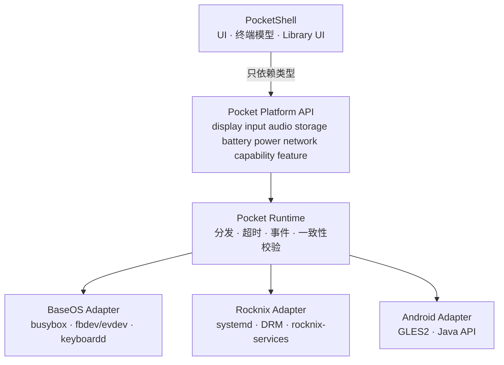

# CPR104 — PocketShell 平台解耦设计（第一阶段）

> **一句话结论**：PocketShell 今天之所以和平台绑死，不是因为它「用到了平台功能」，而是因为**平台没有提供查询接口，只提供了路径和命令名**——所以解耦的唯一杠杆是把 `/sys`、`/dev`、`/proc`、`systemctl`、`amixer`、`heya-control` 这些事实换成**九个域的三态查询 API**，并把每个平台的具体实现收进一个由构建期选定、Shell 永远看不见的 Adapter。

---

## 1. 文档索引

| 文件 | 内容 | 一句话结论 |
|---|---|---|
| [01-audit.md](01-audit.md) | 当前耦合审计（文件 + 调用点 + 依赖类型） | Shell 的每条平台依赖都能指到具体行；并且发现了 4 处**代码与产物已经不一致**的契约漂移，必须先拍板基准。 |
| [02-repo-boundaries.md](02-repo-boundaries.md) | 仓库边界与依赖方向 | 把「2 个仓里挤了 4 层」拆成 Shell / API / Runtime / Adapter 四层单向依赖，并给出可执行的反泄漏判据。 |
| [03-platform-api.md](03-platform-api.md) | 九域 TS 签名 + 错误语义 + 版本协商 | 全部异步、缺失三态、无平台词汇；每域都标了「可以拒绝」与「必须实现」，后者就是 Shell 布局的最小依赖集。 |
| [04-capability-feature.md](04-capability-feature.md) | Capability/Feature 模型 | Capability 答「有没有」（三态），Feature 答「能干什么」（三态 + 单向依赖），并给出与 PocketJS 30 条能力词表的映射规则。 |
| [05-adapters.md](05-adapters.md) | 三份 Adapter 契约 + 最小组网图 | 同一份 `pocket-shell.pocket` 跑 BaseOS/Rocknix/Android 三处，差异只体现为三态而不是代码分支。 |
| [06-local-dev.md](06-local-dev.md) | 本地开发模式 | 四层可独立运行（纯模型 / mock / 无头渲染 / 桌面窗口），L2「无头出像素」是当前缺失的关键一环。 |
| [07-mock-and-tests.md](07-mock-and-tests.md) | Mock 策略与测试矩阵 | 「不允许推断」变成 CI 可执行项：能力为 `no` 时断言对应域方法**从未被调用**；跨平台差异用 D1（语义一致率）作主指标。 |
| [08-migration.md](08-migration.md) | 分步迁移计划 | 9 步（M0–M8），每步单独可合并可回滚，M0–M4 都能做到「平台侧零 diff」。 |

---

## 2. 现状三段话

1. **Shell 被编译进平台。** `rocknix/projects/ROCKNIX/packages/apps/pocketjs-runtime` 一个包同时产出：Shell UI（`hello/`）、PTY/ANSI 模型（`scripts/pocketshell-terminal.rs`，1625 行）、三个字符串桥、启动脚本、systemd 单元、字体、profile 哈希。BaseOS 侧靠 `overlay/usr/sbin/frontend-session` 按**文件名**挑前端并 `exec /lib/ld-linux-aarch64.so.1`。
2. **Shell 自己解析平台。** 亮度读 `/sys/class/backlight`，音量 fork `amixer`/`pactl`，电量读 `/sys/class/power_supply/*/capacity`，IP 解析 `ip -o -4 addr show`，服务开关调 `rocknix-services`，音量/无线写调 `heya-control`，休眠靠 Python 守护读 `/dev/input` 写 `/sys/class/backlight`。这些都跑在 guest 渲染线程上，所以每次调用都要 `/usr/bin/timeout 2` 包一层。
3. **换平台的代价是「模仿」。** PJOS 为了跑同一个 Shell，规划过 `rocknix-services`/`heya-control`/`systemctl`/`pocketshell-games`/`pocketshell-play` 的 compat shim（`docs/13-pocketjs-on-baseos.md:40` 的 G3，`:57` 的「兼容层」），并在恢复模式里提到「不需要 `rocknix-*`、`python3`」（`:153`）——即在平台 A 上重新实现平台 B 的命令名。这不是适配。

---

## 3. 目标形态（一图）

三条硬规则：

| 规则 | 判据 |
|---|---|
| Shell 不知道平台 | Shell 源码里 `rocknix`/`baseos`/`android`/`h700`/`rg34xx`/`m21` 零命中 |
| Shell 不读设备 | Shell 源码里 `/sys`/`/dev`/`/proc` 零命中 |
| Shell 不推断 | 能力为 `no` 时，对应域方法在测试中**从未被调用** |

---

## 4. 耦合 top 风险

| # | 风险 | 证据 | 影响 |
|---|---|---|---|
| R1 | **源码与产物已不一致**：tracked `hello/main.tsx` 350 行，预编译产物里是 1033 行；`pocketshell-launcher.rs` 存在四份实现（91 / 285 / 324 / 319 行，动词集互不相同） | [01](01-audit.md) §7.1（含复现命令与实测计数） | 「零行为变化」没有可信基线，任何迁移都可能悄悄改行为 |
| R2 | **三份 profile 互相矛盾**（`[[360,240],[720,480]]`/density 1 vs `[[360,240]]`/density 2），而 profile 哈希进包准入 | [01](01-audit.md) §7.3、`generated/pocket_profile.rs:3-19` | Shell 的视口/缩放数学与真机不符；重建会换 profile 哈希 |
| R3 | **查询跑在渲染线程**，靠 `timeout 2` 兜底 | `PKT/.../pocketshell_launcher.rs:3-19` 的注释记录了 `pactl` 导致整屏冻结的事故 | 任何慢查询都变成掉帧或黑屏 |
| R4 | **终端行格式发出 5 段、解析 4 段**，列号被当文字 | `pocketshell-terminal.rs:715`（发出 5 段）+ `:1215`（注释写明 5 段）vs `hello/main.tsx:127`（只取 4 段） | 逐帧比对全是噪声；UI 文本实际已错位 |
| R5 | **启动序没有版本与能力协商**，只有文件名约定 | `frontend-session:164-183` | 新 Shell 无法声明「我需要什么」；不兼容只能表现为黑屏或静默降级 |
| R6 | **上游 patch 面积大且脆**（anchor 一移动就 `SystemExit`） | `patch-runtime.py:20-26`（`replace()` 的 fail-closed）、`:34-52`（三个桥的注入） | 升级 pocketjs 的成本不可预测 |
| R7 | **服务开关与应用启动不在九域内**，但 Shell 现在承担它们 | `SERVICE`/`LAUNCH` 的桥实现 | 平台化后这部分 UI 必须消失或改由 PocketApps 承担，是**用户可见的行为变化** |

---

## 5. 需要用户拍板的决策点

| id | 决策 | 选项 | 不拍板的后果 |
|---|---|---|---|
| **D1** | 迁移基线用哪份源码？ | (a) 以预编译产物（`apps/rocknix-h700/main.tsx` 1033 行 + V3 桥 324 行）为行为基准，把 tracked 源码补齐；(b) 以 tracked `hello/`（350 行 + V1 桥 91 行）为基准，接受功能回退 | 「零行为变化」无法定义，每个 PR 都无法验收 |
| **D2** | `pocket-runtime` 是独立仓，还是留在各平台仓内？ | (a) 独立仓 + pin；(b) 留平台仓，只把 API 契约独立 | 决定 Android 能否不经 BaseOS/Rocknix 构建就验证 |
| **D3** | PTY 机制归 Runtime 还是各 Adapter？ | (a) Runtime 统一提供；(b) Adapter 各自实现，Runtime 只给字节流 | 决定 Android 上终端工作区是「设计上不支持」还是「待实现」 |
| **D4** | 允许长期 patch pocketjs 吗？ | (a) 收敛到单一 Adapter 注册点；(b) 推动上游提供扩展点 | 决定升级成本与长期可维护性 |
| **D5** | 服务开关（11 个 key）与 `LAUNCH` 归谁？ | (a) 删除，由 PocketApps 的 `pocket-settings` 承担；(b) 扩第九域之外的新域（超出本阶段范围） | Shell 会保留一个没有平台接口的功能，等于继续耦合 |
| **D6** | Android 第一阶段是否做 `openTextSession`？ | (a) 直接接 `InputMethodManager`；(b) `unsupported`，Shell 自绘 | 决定 Android 上的文本输入体验，以及 Shell 要不要保留自绘键盘 |
| **D7** | M21 能否安装并启动 APK？ | 需要一次实测确认 | 若不能，Android 分支整体阻塞（这是 M21 的**唯一**前置，不需要解锁/BSP） |
| **D8** | golden 存在哪一层？ | (a) 只订 L2 软件栅格（推荐）；(b) 也订设备 | 订在设备会让每次 GPU 驱动更新都要重录 |

---

## 6. 本阶段做了/没做

| 做了 | 没做 |
|---|---|
| 九份设计文档，全部结论指到 `文件:行` | 任何实现代码 |
| 三份 Adapter 契约表（含「不实现」清单） | 任何 build/overlay/源码改动 |
| 迁移 9 步，每步含验证命令与零影响判据 | 真机验证（本阶段不改代码，无可验证面） |
| 反泄漏 grep 词表与三态一致性校验规则 | 契约仓/Shell 仓的实际创建 |

---

## 7. 仍然存疑

| # | 存疑 | 为什么无法在本阶段消除 |
|---|---|---|
| U1 | BaseOS 的亮度控制节点（`/sys/class/disp/disp/attr/enhance_bright`）是否可用 | 需要真机写入并观察面板；`docs/13` 只记录「节点存在」 |
| U2 | Rocknix 上 `bluetooth.sink`/`source` 的实际可用性 | 仓库内无实现证据；`docs/06` 只验证到「守护启动」 |
| U3 | 跨平台 D1=100% 是否可达（尤其文本行） | 需要三台设备各跑一次才能知道真实差异集 |
| U4 | Android 上 `audio.pcm` 缺失对「Music App 验证」的影响范围 | 需要先确认 Music App 的形态（Shell 内页面 vs 外部 PocketApp） |
| U5 | `origin/main`（比本地 `main` 新 41 个提交）上桥接实现是否有变化 | 审计只对比了 `hello/main.tsx` 行数（593 vs 350 vs 1033），未逐行比对 |
| U6 | `pocket-shell` 脱离 rocknix 后能否在开发机构建（依赖 pinned pocketjs 工具链） | 需要先确定 `pocketjs` 的分发形态（[06](06-local-dev.md) §9 L1） |

---

## 8. 引用基线

| 仓 | 引用 | 说明 |
|---|---|---|
| PJOS-LINUX | `dc99d574c9e0bd9c3cf87cd1008ea02db4bd56ac`（`origin/main` 同） | 本次 worktree 的基线 |
| rocknix | `e484b261d2c3d9c8732be613a670ff0dc7431f51`（本地 `main`） | **落后 `origin/main` 41 个提交**；引用只对该 SHA 成立 |
| pocketjs（pinned） | `e6770376626a4de5c93eaa6fb048e7e9ffb81f9f` | rocknix 构建树内的 upstream 源码，`package.mk:3` 固定 |
| PJOS 子模块性质引用 | `runtime/keyboardd`（本仓）、`pjos-input-framework`（`1b0b872`）、`pjos-keyboard`（`d92a2d5`） | 输入框架的跨仓契约 |
| 应用侧参考 | `pocket-settings`（`865a2e5`）、`pocket-launcher`（`0245d98`）、`pocket-files`（`800bcae`） | 只读，用于提取已有的能力模型范式 |
| M21 证据 | `m21-baseos-assessment`（`d5f6ea7`） | 只支持到「OTA 元数据已验证」，硬件与解锁均未验证 |
