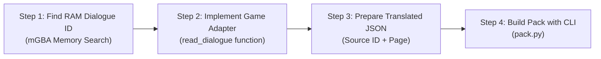

# How to Adapt Any Retro Game to RetroBilingual

RetroBilingual is designed as a **modular framework**. While the reference implementation includes an adapter for *The Legend of Zelda: The Minish Cap*, you can adapt **any other GBA (or retro) game** in four straightforward steps.

---

## Overview of the Adaptation Workflow



---

## Step 1: Finding Dialogue ID in Game RAM

Every retro game keeps track of the currently active dialogue in RAM. In GBA games, this is located in EWRAM (`0x02000000` - `0x0203FFFF`).

### Using mGBA / No$gba Memory Search:
1. Open the target game in mGBA on your PC.
2. Advance to a dialogue scene.
3. Open **Tools -> Memory Search**:
   - Talk to Character A -> Note potential 16-bit values that changed.
   - Advance dialogue to Character B -> Filter by changed values.
   - Close dialogue -> Filter for values that reset to 0.
4. Within 15–30 minutes, you will discover the memory address containing the active `textIndex` or string pointer.

### Checking Multi-page Dialogue State:
Look near the `textIndex` address for a byte that changes when:
- The text finishes scrolling and waits for the `A` button (`WAIT` state).
- The player presses `A` to flip to the next page (`NEXT` or `ROLL` state).

---

## Step 2: Implement the Game Adapter

Create a new file in `core/adapters/<game_id>.c` implementing the `RBAdapter`
interface. `rom_size` and `sha256_hex` are compared against the **unpadded
file size**: mGBA's `GBA.memory.romSize` is rounded up to the cartridge mask,
so the core hashes `GBA.pristineRomSize` when available. A pack whose SHA is
built from the file will never load if the adapter gates on the padded size.

```c

#include "adapter.h"
#include <mgba/core/core.h>
#include <mgba/internal/gba/gba.h>

#define POKEMON_EMERALD_ROM_SIZE 0x01000000
#define POKEMON_EMERALD_SHA256   "..."

static uint16_t sCurrentTextId = 0;
static uint8_t  sCurrentPage = 0;

static void emerald_reset(void) {
    sCurrentTextId = 0;
    sCurrentPage = 0;
}

static int emerald_read(struct mCore* core, uint16_t keys,
                        uint16_t* out_text_id, uint8_t* out_page) {
    if (!core) return 0;
    const struct GBA* gba = (const struct GBA*)core->board;
    if (!gba || !gba->memory.wram) return 0;

    /* Read text ID from discovered RAM offset. keys uses the internal
     * libretro keymap: bit 0 = A, bit 1 = B, ... */
    uint8_t* ewram = (uint8_t*)gba->memory.wram;
    uint16_t textId = (uint16_t)(ewram[0x20000] | (ewram[0x20001] << 8));

    if (textId == 0 || textId == 0xFFFF) return 0;

    if (textId != sCurrentTextId) {
        sCurrentTextId = textId;
        sCurrentPage = 0;
    }
    /* Increment sCurrentPage if advance condition is met */

    *out_text_id = sCurrentTextId;
    *out_page = sCurrentPage;
    return 1;
}

const RBAdapter g_rb_adapter_pokemon_emerald = {
    .game_id = "pokemon_emerald",
    .title = "Pokemon Emerald",
    .rom_size = POKEMON_EMERALD_ROM_SIZE,
    .sha256_hex = POKEMON_EMERALD_SHA256,
    .reset = emerald_reset,
    .read_dialogue = emerald_read,
    .page_slack = 0, /* set 1 if A can briefly overshoot the next page */
};
```

---

## Step 3: Prepare the Translation Dataset

Create a JSON file containing the translated text mapped to `source_id` (the 4-digit hex representation of `textIndex`) and `page_index`:

```json
[
  {
    "source_id": "0100",
    "page_index": 0,
    "text": "Hello world!\nWelcome to the game!"
  },
  {
    "source_id": "0100",
    "page_index": 1,
    "text": "Press A to continue your adventure."
  }
]
```

### Formatting Guidelines:
- **Max 2 lines per dialogue box**: Standard GBA textboxes comfortably fit 2 lines of text. Use a single newline `\n` to separate lines within the same page.
- **Page breaks**: When a character's speech spans multiple dialogue boxes requiring `A` presses, specify them as separate entries with `page_index: 0`, `page_index: 1`, etc.

---

## Step 4: Build the Runtime Pack

Use the bundled `tools/pack.py` utility to generate the compact binary pack:

```bash
python3 tools/pack.py \
  --texts /path/to/translations.json \
  --source-rom-sha256 <64_character_hex_hash> \
  --font /path/to/any_truetype_font.ttf \
  --font-size 12 \
  --output retrobilingual.pack
```

The resulting `retrobilingual.pack` contains:
- The target ROM SHA-256 identity gate.
- A 1bpp pre-rendered font atlas containing **only the glyphs used in your translation** (saving huge amounts of RAM).
- Fast $O(\log N)$ sorted index table for microsecond lookups during live gameplay.

Place `retrobilingual.pack` into `~/.config/pocketjs/` (or your device's configuration directory), and your game is now fully bilingual!
